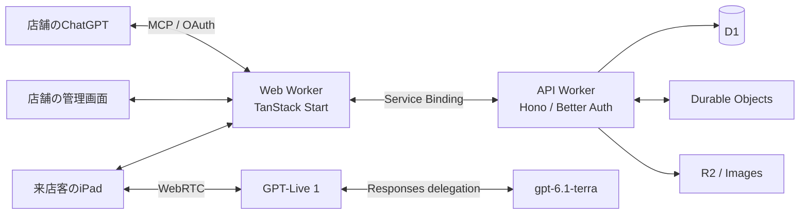

<picture>
  <source media="(prefers-color-scheme: dark)" srcset="docs/design/logos/tablecast-lockup-white.svg" />
  
</picture>

# TableCast PoC

そばで相談に乗る店員と、店固有のお品書きを卓上iPadに。

TableCastは、声による接客とタッチ式注文を一つのカートにつなぐ、飲食店向けシステムのPoCです。料理やお酒のおすすめを聞き、好みに合わせてカスタマイズし、内容を確認して注文できます。来店客の画面と店舗の管理画面は、どちらも日本語・英語に対応します。

[デモ](docs/demo.md) · [紹介動画](apps/presentation/README.md#現在の成果物) · [セットアップ](docs/setup.md) · [構成仕様](docs/architecture.md) · [仕様索引](docs/README.md)

## できること

- **声とタッチで注文** — 商品説明、おすすめ、カスタマイズ、飲み放題などのプランの相談から、同じカートを操作できます。音声を停止しても画面から注文を続けられます。
- **店舗の状況を共有** — 卓・来店・注文・提供・会計・スタッフ呼出しを管理し、変更をリアルタイムに表示します。
- **ChatGPTから店舗設定** — MCP経由でメニュー資料や翻訳、接客方針、画像を下書きへ反映し、差分を確認して公開できます。
- **店舗に合わせた接客と表示** — 日英の商品名・説明・読み上げ名、接客指示、音声、テーマやロゴを店舗ごとに設定できます。
- **会員と卓上ゲーム** — 明示ログインと同意に基づく店舗別の記憶・ポイント・クーポン、店舗が承認したゲームを扱います。

来店客の決済処理とPOS本接続は対象外です。会計の支払済み登録はスタッフによるモック操作です。店舗のTableCast利用料を扱う[組織向け課金・請求](docs/billing.md)とは区別します。

## 技術スタック

TypeScriptを中心に、WebとAPIをCloudflare Workersで動かす構成です。依存バージョンは各workspaceの`package.json`とルートの[`bun.lock`](bun.lock)で管理します。

| 領域                 | 採用技術                                                        | 役割                                                                    |
| -------------------- | --------------------------------------------------------------- | ----------------------------------------------------------------------- |
| Web・SSR             | React 19、TanStack Start / Router、Vite                         | 卓上画面・店舗管理画面、ルーティング、サーバーレンダリング              |
| データ取得・フォーム | TanStack Query / Form / Table                                   | SSRとのデータ共有、キャッシュ、入力検証、一覧表示                       |
| UI                   | Tailwind CSS 4、shadcn/ui、Base UI、Tailwind Variants、Motion   | 共通部品、店舗テーマ、アクセシビリティ、画面の動き                      |
| 多言語               | Paraglide JS                                                    | 来店客・スタッフそれぞれの日本語・英語表示                              |
| API・入力検証        | Hono、Hono Client、Zod                                          | 型を共有するHTTP API、店舗・卓の認可、共通業務操作                      |
| 音声会話             | OpenAI GPT-Live 1、WebRTC                                       | ブラウザーとモデルを直接接続する音声理解・応答・再生                    |
| 業務の委任           | OpenAI Responses delegation、gpt-6.1-terra                      | 音声会話中の業務判断とtool呼出し。Fast mode、reasoning low              |
| 認証・利用契約       | Better Auth、Stripe                                             | スタッフ・組織・会員の認証、OAuth、店舗のサブスクリプション・AI従量課金 |
| データベース         | Cloudflare D1、Drizzle ORM                                      | 店舗設定、カート、注文、会計、永続イベントの保存                        |
| リアルタイム通知     | Cloudflare Durable Objects、WebSocket                           | 店舗・卓の変更通知と再接続時の同期                                      |
| 画像                 | Cloudflare R2、Cloudflare Images                                | 商品・店舗画像の保存、配信、サイズ変換                                  |
| 外部連携             | Model Context Protocol SDK、@hono/mcp                           | OAuthで認可した店舗設定・統計操作をChatGPT等へ提供                      |
| 観測                 | OpenTelemetry、Grafana LGTM                                     | HTTP・業務・モデルのtrace、ログ、メトリクスの確認                       |
| 開発・ビルド         | Bun workspaces、Turborepo、mise、Docker Compose / Dev Container | 依存管理、タスクの順序・並列実行、worktreeごとの開発資源の分離          |

検証にはVitest、Storybook、Playwright、静的検査にはOxfmt、Oxlint、TypeScript、fallow、Git hooksにはLefthookを使います。動画は[`apps/presentation`](apps/presentation/README.md)でHyperFrames・GSAP・FFmpegを使って制作します。

## アーキテクチャ



GUI・音声の業務tool・MCPは、API内の同じ業務操作を呼び出します。価格・販売可否・プラン・権限はAPIで判断し、注文は版付きの確認スナップショットと明示承認を経て確定します。

WebとAPIは2つのWorkerに分け、Service Bindingで接続します。音声はブラウザーとGPT-Live 1のWebRTC接続を使い、業務toolの実行要求はWeb経由でAPIへ渡します。D1を業務状態の正本とし、Durable Objectsが更新を通知します。詳細は[構成仕様](docs/architecture.md)、[音声接続](docs/voice/integration.md)、[注文仕様](docs/product.md#共通の注文操作)を参照してください。

## デモと紹介動画

架空の京料理店、バーガー店、韓国料理店を用意しています。異なるメニューやカスタマイズ、複数人での相談、注文の訂正、スタッフ側の受付・会計を同じシステムで試せます。

店舗管理画面の会話注文デモでは、卓への端末割当てをせずに、公開中の設定や未公開の下書きを試せます。デモの注文や呼出しは通常営業と分離して記録します。

- [デモの起動・データ・リセット](docs/demo.md)
- [店舗・ペルソナ・会話シナリオ](docs/demo/README.md)
- [商品紹介・技術紹介動画と制作手順](apps/presentation/README.md)

## 開発を始める

[セットアップ手順](docs/setup.md)に、clone、Issue用worktree、環境変数、起動確認、終了までをまとめています。Dev Container、またはmiseで管理したNode・BunとDockerを使います。必要なバージョンは[`mise.toml`](mise.toml)とセットアップ手順を参照してください。

ホストでの開発環境を準備したworktreeでは、ルートで次を実行します。

```sh
bun --no-env-file run setup
# ホスト開発の初回に共有proxyを起動する
bunx --no-install portless proxy start --no-tls --port 80
bun --no-env-file run dev
```

起動ログに表示される`http://web.<worktree名>.tablecast-poc.localhost`を開きます。Dev Containerでは[専用の起動手順](docs/setup.md#2a-dev-containerを使う)に従ってください。

外部APIキーなしでGUI注文・ローカル認証・メールを開発できます。実音声の利用設定と資格情報は[`.env.example`](.env.example)と[音声接続](docs/voice/integration.md)を確認してください。

## リポジトリ構成

| 場所                                     | 役割                                                 |
| ---------------------------------------- | ---------------------------------------------------- |
| [`apps/web`](apps/web)                   | 来店客・店舗・会員向けUI、SSR、WebRTC、併設Storybook |
| [`apps/api`](apps/api)                   | 業務API、認証・認可、DB、音声tool、MCP、通知         |
| [`apps/emulate`](apps/emulate)           | 開発・PRプレビューのOAuthエミュレーター              |
| [`apps/presentation`](apps/presentation) | 紹介動画の収録・制作・生成・検査                     |
| [`plugins/tablecast`](plugins/tablecast) | 店舗向けCodex pluginのMCP接続設定とskills            |
| [`scripts`](scripts)                     | 開発環境、合成データ、配備・検証のCLI入口            |
| [`assets/demo`](assets/demo)             | デモの商品・店舗画像と出所の記録                     |
| [`infra`](infra)・[`.github`](.github)   | 観測設定、CI、PRプレビュー・公開環境への配備         |
| [`docs`](docs/README.md)                 | 製品・構成・業務・開発運用の仕様と検証記録           |

## 検証

| コマンド               | 確認するもの                                           |
| ---------------------- | ------------------------------------------------------ |
| `bun run check`        | 生成処理、整形、lint、型、fallow、無課金テスト         |
| `bun run test:browser` | Vitest Browser Mode・StorybookによるUI部品と操作       |
| `bun run test:e2e`     | Playwrightによる実Web・API・DBを接続した代表業務フロー |
| `bun run storybook`    | UI部品と表示状態の開発用プレビュー                     |

必要な依存と実行条件は[日常の操作](docs/setup.md#5-日常の操作)、検証の分担は[テスト戦略](docs/testing.md)を参照してください。実音声・実iPad・公開環境の受入状況は[実装・検証記録](docs/progress.md)で確認できます。

## 詳細ドキュメント

- 製品・業務：[製品仕様](docs/product.md)、[注文](docs/product.md#共通の注文操作)、[会員](docs/membership.md)、[ゲーム](docs/game-plugins.md)
- 接続・運用：[認証](docs/authentication.md)、[MCP](docs/mcp.md)、[観測](docs/observability.md)、[配備](docs/deployment.md)
- 開発・貢献：[作業契約](AGENTS.md)、[開発環境の仕組み](docs/development.md)、[テスト戦略](docs/testing.md)、[受入条件](docs/acceptance.md)
