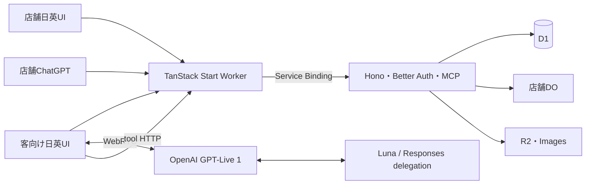
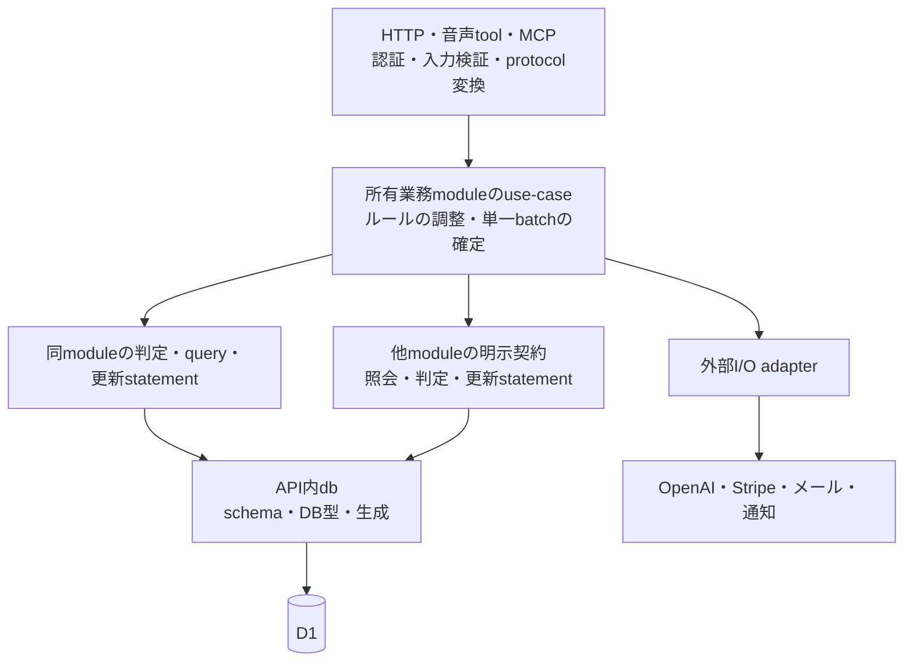

# 構成とディレクトリ

[索引](README.md)

ゲームの登録・公開・プレイ状態はAPIの`modules/games`が所有する。既存R2とD1を使い、生成コードはsandbox iframeで本体から隔離する。共通の実行表示は`components/game-frame`、保存・公開操作は各featureが所有する。[ゲームプラグイン仕様](game-plugins.md)を参照する。

## 実行単位



Web/APIの2 Workersをアプリの実行単位にする。DOのclassはAPI Workerに置き、PRのOAuth emulatorだけをContainerに置く。音声サーバーやPython runtimeは運用しない。
業務の正本はD1。GPT-Liveは音声理解・会話・音声生成、LunaはGPT-Liveの標準Responses delegationによる業務判断、Honoは共通業務ツールの認可・実行、DOは通知とサーバー側の音声利用量収集を担当する。

カメラの取得・切替・圧縮と表示はWebが所有する。認可した`captureCamera`の結果を受けたときだけ現在の1枚をResponsesへ直接入力し、API・D1・R2へ画像を複製しない。Responsesの標準Web検索は参考情報へ使い、業務判断の根拠は共通APIに保つ。参考ページの取得制限と表示イベントはAPIのvoice module、QR・OGP・公開推論要約の描画はWebのkiosk featureが所有する。

組織ごとのOpenAI Service Account・暗号化鍵・利用量台帳・Costs snapshotはAPIの`modules/billing`が所有する。サブスク・Checkout・Portal・Webhook同期はBetter Auth公式Stripe pluginを使い、顧客料金の送信はStripe Metersへ任せる。原価を卓へ配賦しない。[課金・請求仕様](billing.md)を参照する。

## ディレクトリ

APIは業務moduleごとに入力、操作、読取を所有する。処理がない層のファイルは作らない。

業務RPCは`app.ts`の`rpcRoutes`で構成し、`handleRpcError`が例外を公開JSON契約へ揃える。認証・MCP・メディア等は既存のprotocol応答を維持する。`client.ts`は公開`schema.ts`のエラー型を参照し、Honoの`ApplyGlobalResponse`で通常と卓sessionのclientへ共通応答を追加する。Webのfetchは通信だけを担い、解析は標準`parseResponse`、例外本文の検証は公開`apiErrorSchema`を使う。既存の`traceId`はrequest IDであり、OTelのtrace IDとは区別する。

入力検証の`INVALID_INPUT`には`path`・`code`・日英の`messages`を返す。Zod 4標準のlocalesをparse単位で使用し、入力値・正規表現・元のZod例外を公開しない。Webは同じ公開schemaでローカル検証し、APIの項目エラーをTanStack Formの`onServer`へ接続する。項目のラベルと具体的な制約を併記し、形式に業務固有の説明が必要な場合だけ既存のUI翻訳を使う。項目へ対応付けられない失敗は共通通知へ残す。

```text
tablecast/
├── apps/
│   ├── api/src/
│   │   ├── app.ts・worker.ts          # HTTPとWorkerの組立て
│   │   ├── client.ts・schema.ts       # Web向け公開契約
│   │   ├── db/
│   │   │   ├── public.ts・client.ts  # CLIの限定入口、DB生成・型
│   │   │   ├── auth-schema.ts        # 認証schemaの公開面
│   │   │   └── *-schema.ts           # 業務別のschema
│   │   ├── modules/
│   │   │   ├── orders/use-cases/     # カート・確認・確定・入金
│   │   │   ├── tables/               # 卓・session・表示投影
│   │   │   ├── voice/                # 停止意思・認可・利用量・委任
│   │   │   ├── auth/                 # 認証runtimeと認可
│   │   │   └── その他の所有業務/
│   │   ├── emails/                   # 文面・template・送信時の描画とtransport
│   │   ├── integrations/             # 解決済み入力を受ける外部protocol
│   │   ├── platform/                 # request依存・エラー・観測
│   │   └── realtime/                 # DO通知
│   ├── web/src/
│   │   ├── routes/                   # loader・URL・ページ合成
│   │   ├── features/
│   │   │   ├── store/                # 店舗選択・プロフィール・権限
│   │   │   ├── floor・catalog・configuration・devices/
│   │   │   ├── rewards・statistics・demo・games/
│   │   │   ├── kiosk/                # session・cart・checkout・voice・描画
│   │   │   ├── account・billing・customer/
│   │   │   └── shell/                # 受け取ったデータのレイアウト
│   │   ├── components/ui/            # 業務非依存のUI
│   │   ├── components/               # 共通表示
│   │   └── lib/                      # HTTP・SSR・ブラウザー境界
│   ├── presentation/                 # 収録・制作・動画生成
│   └── emulate/                      # 開発・PRのOAuth模擬
├── scripts/                          # 既存CLI入口と用途別処理
├── fixtures/demo/
├── docs/
├── .agents/skills/
└── package.json・bun.lock・turbo.json・oxlint.config.ts・lefthook.yml
```

rootのBun workspacesは `apps/*`。`@tablecast/web`、`@tablecast/api`、開発・PR認証用の `@tablecast/emulate` を置く。依存はrootの `bun.lock` で固定する。

## 業務moduleと依存の寿命

Webは機能単位のfeature、APIは業務単位のmoduleを基本にする。小さな処理にcontroller/service/repository/interfaceを一組ずつ生成しない。
同じ状態・寿命・変更理由を持つ処理は同じ所有者へまとめる。一回しか使わないhookとviewの間で多数の状態を返して再展開するだけなら、同じ編集・接続・表示の処理へ戻す。ファイル内の関数・privateメソッド・表示componentで役割を整理し、公開契約・独立したI/O・mount・購読の境界は維持する。実装300行は分割を強制する上限ではなくレビューの目安とする。
APIではroute・音声のfunction・MCPが同じ注文操作関数を呼び、必要なDrizzle queryと純粋な価格・条件判定をそこから利用する。
HTTPはHono公式のfactoryでEnvとmiddlewareの型を共有し、パスと操作を登録するchainからHono Clientへ型を伝える。共通のrequest準備はrootだけで行い、入力検証と認証の順序は各入口の契約として維持する。店舗・卓・本人のscopeを確定するguardを再利用し、GUI・音声・MCPから直に呼ばれる業務側の認可も保つ。
価格計算等を `pricing.ts` に切り出すことは有用だが、そのための共有domain packageは不要。
DB queryが十分短ければ操作関数内に置いてよい。複雑なqueryの所有ファイルを分ける場合も、単なる引数の中継層を追加しない。

`app.ts`はHonoの共通middlewareとmoduleを組み立てる。`platform/context.ts`の`requestServices`がHTTPリクエストごとにDrizzleを一度生成し、同じ`ApiServices`をroute・service・Agentツールへ渡す。`db/client.ts`のDB factoryが認証schemaの関連queryを有効にする。schemaとfactoryはHonoや認証runtimeへ依存せず、D1 handleの寿命はWorkerまたは運用CLIが所有する。Better Authは最初の利用時に同じDBで生成し、スタッフsessionの取得PromiseはHono Contextで共有する。次のリクエストへDB・Auth・sessionを持ち越さず、healthや画像はAuth設定に依存しない。

同じ要求で認可済みの卓行とデモ所有者の確認結果は`ApiServices.tableAccess`で共有する。`context.ts`から`db/records.ts`への型参照をこの境界に限り許可し、schemaのruntimeをplatformへ持ち込まない。卓行は最初の業務読取で消費し、更新後の状態は最新のD1 batchから構成する。デモの認可結果はデモID・店舗・利用者・音声sessionの一致を確認し、別要求へ保持しない。DB更新とイベント保存の確定後、通知は同じ要求の`backgroundTasks`からWorkerの`waitUntil`へ渡す。HTTPの成功を通知配送に依存させず、失敗ログとイベント再取得を維持する。

HTTP認可のmiddlewareとrouteは共通のtelemetryへ依存し、認可と業務操作の時間を別々に測る。認可層からDB更新や業務処理への依存は増やさない。

Drizzle ORM・Kitは`1.0.0-rc.5`を使い、認証のRelations v2とBetter Authの対応adapterを同時に扱う。DB列と同義の入力は`drizzle-orm/zod`から必要なfieldだけを選び、業務の制約を重ねる。JSON列内の設定・snapshot等は業務Zod schemaを正本にし、DBの文字列列から生成しない。行型はDrizzle、公開HTTPの入出力型はZodとHono Clientから推論する。WebへDB schemaのruntime依存を渡さない。

| 所有者                                                                                  | 責務                                                                       |
| --------------------------------------------------------------------------------------- | -------------------------------------------------------------------------- |
| `platform/context.ts`、`platform/http.ts`                                               | リクエスト依存、trace・Origin検査、共通エラー応答                          |
| `modules/auth/middleware.ts`                                                            | スタッフ認証、店舗membership、端末CookieからActorを確定                    |
| `modules/*/routes.ts`、`*-routes.ts`                                                    | HTTP入力の検証、認可middleware、業務操作呼出し、JSON・Cookie・streamの出力 |
| `modules/*/use-cases/*.ts`・`service.ts`、音声の`session.ts`・`realtime.ts`・`turns.ts` | Hono Contextに依存しない業務判断、条件付き更新・batch、音声の競合・停止    |
| `modules/*/queries.ts`、`tables/history.ts`                                             | 複数呼出し元で利用する読取、tenant条件、集計・ページング                   |
| `modules/*/model.ts`                                                                    | 業務別の入出力schema・型。共通のID・言語は`platform/model.ts`              |
| `db`、`migrations`                                                                      | D1 schema・制約・移行。汎用repositoryや別DBのadapterは設けない             |

卓・フロア・下書きの表示読取は、既存のquery builderをD1の`db.batch()`へまとめる。卓・フロアの回復cursorは同じbatchの状態読取より先に取得し、取得後の更新をイベント経路で回収する。カゴ更新は更新・確認失効・イベント保存の後へ同じ状態読取queryを置き、一つのbatchで確定値を返す。更新成立の判定と通知はordersのuse-caseが所有し、queryは読取statementと型付き結果変換だけを公開する。デモの作成者と現在の店舗権限はjoinで確認してから結果を返す。通常端末のカゴ・確認では認可と同じjoinで商品設定を取得し、同じ卓・店舗のプランなし価格判定へ再利用する。デモの商品設定も認可時の値を同じデモ・店舗だけで共有する。他のGUI操作は認可時に設定JSONを余分に取得せず、プラン利用中は従来どおり注文履歴と価格設定をまとめて読む。いずれもリクエスト内に限り、更新時の設定版検査と更新後の再読取は維持する。カタログのqueryと結果変換は単独取得・batchで共有し、D1が列名で返すbatch結果ではjoin先の重複列に別名を付ける。

GUI・音声・MCPは同じ所有moduleのuse-caseを利用する。注文確定のsnapshot、版の比較、mutation_id、`changes()`を用いた条件付きbatchは元の原子性を保つ。serviceからrouteを呼び戻さず、音声接続の制御は`voice/runtime.ts`へ依存する。

HTTP入力schemaは所有moduleに置く。Web向けのHono RPC clientは `@tablecast/api/client`、共有が必要な公開型・schemaだけは `@tablecast/api/schema` から明示公開する。
メニュー検索の純粋関数は `@tablecast/api/catalog-search` から公開し、音声ツールと店側で共有する。`modules/catalog/search.ts` だけがFuse.jsへ依存し、Webは取得済みの公開版・下書きの設定ごとに索引を再利用する。DB・認証・価格判定・モデル実行をこの公開入口へ含めない。
これはAPI自身の公開面であり、別のcontracts packageではない。WebがAPIのDB・auth・モデル実行コードをruntime importしないことをbuildで確認する。
型はtype-only importで扱い、画面専用のstateと業務契約を無理に一つにしない。音声のブラウザーとAPIの契約も同じ公開schemaを使う。全APIの巨大SDKは生成しない。
Webの取得定義は既存の`queryOptions`・`infiniteQueryOptions`、更新定義は共有する処理がある場合の`mutationOptions`を使う。応答型を得るためだけのload関数を作らず、公開clientの成功応答から推論する。cache key・版・cursor・取消signalを定義と一緒に保ち、共通cache更新と画面固有の入力・focus・遷移をそれぞれの所有者で扱う。

共有packageを作るのは、実在する独立した複数consumerと、切り出した方が変更箇所を減らす根拠がある場合だけ。

## 操作の所有と公開入口



中央の`operations`や汎用workflow runnerは作らない。注文確定はorders、卓の開閉はtables、音声開始停止はvoice、ポイント交換はcustomer-points、券の発行・適用はcustomer-couponsが所有する。他moduleが必要な読取・純粋な判定・準備済み更新statementを公開し、一つのuse-caseが版条件とbatch成功の確認を所有する。独立commitするuse-caseを連鎖させない。版条件・確認失効・event cursorなど実在する下位契約だけを共有する。

`@tablecast/api/db`は運用CLI向けのschema・DB生成・型、`@tablecast/api/bootstrap`は初期化に限定した公開入口とする。CLIから任意のAPI内部ファイルへ到達させず、Webは両入口を利用しない。認証schemaを認証runtime配下へ移してdb→auth→dbの循環を作らない。DB切り出しは複数の実consumerがあるため将来候補だが、今回は`packages/*`を追加しない。auth client・React Email・WebのUIは変更理由と利用者が異なるため、現在のapp内の所有を保つ。

メールはtemplate・文面を独立させ、送信を所有する`emails/send.ts`が描画とtransportを選ぶ。React Email rendererとtemplateは送信時だけ遅延importする。外部protocol adapterへは資格情報を解決済みの入力を渡し、APIの認可・DBやHonoへ逆依存させない。Oxlint boundariesは所有業務・読取/更新/HTTPの役割・公開入口を検査し、未知の配置も拒否する。行数だけで分割の妥当性を判断しない。

## 単一オリジン

Web入口が `/api/*`、`/mcp`、OAuth metadata、`/media/*` をService Bindingで内部転送する。[S10](sources.md#s10)
別APIホストへのredirectはしない。レスポンスのstream、AbortSignal、複数Set-Cookie、WebSocket upgradeを維持し、bodyを全読みしない。

同一オリジンにすることで広いCORS許可やCookieのドメイン共有は不要になる。ただし通常のSecure/HttpOnly/SameSite、CSRF、認可、OAuth callback設定は必要。
Cookieはhost-only。認証済み応答、カート、注文、ログは共有キャッシュに置かない。
GPT-LiveへのWebRTCメディアは直接通信であり、SDPの開始要求・業務委任・停止だけを認証済みAPIへ送る。

## 認証・設定・公開境界

認可されたコンテキストをHonoが確定して業務関数へ渡す。モデルが指定した店舗IDを信用しない。
MCPのOAuthとブラウザーのCookieをそれぞれ検証し、内部パスという名称だけで安全と扱わない。
開発用seed・リセット・模擬イベントの経路は、本番bundleに含めないか、本番で確実に無効化し試験する。

設定は下書き→検証→公開。公開版は変更せず、新版を作る。注文に適用した商品名・modifier・価格・ルールを保存し、後日の変更から独立させる。
将来のPostgresのためだけにrepository interfaceや二重DB adapterを作らない。D1の実制約と移行手順をテストする方を優先する。

## Web/APIの型境界と店舗

Honoのroute chainから `AppType` を推論し、`@tablecast/api/client` の公開入口で `hc<AppType>` を提供する。Webの業務APIはこのクライアントとHonoの `parseResponse` を使い、レスポンス用Zodを二重定義しない。外部入力のZod検証と認可はAPI側に残す。業務エラーはAPIの共通例外処理で正規化し、WebはHonoの標準`DetailedError`を読む。

`components/ui` は業務を知らないshadcn/Base UI部品、`components` はDataTable・日時・ユーザー表示、`features/store` は店舗選択・プロフィール・権限、`features/catalog`・`configuration`・`devices`は各業務、`features/account` は本人の認証設定を所有する。ai-elementsは `components/ai-elements` に置く。

migration 0011で店舗と組織を1対1にする。以前の複数店舗組織は店舗単位へ分割し、管理者は各店舗、一般メンバーは従来所属していた店舗へ引き継ぐ。旧teamの表は移行履歴として残すが、アクセス判定では使わない。店舗・卓・注文のIDとカートは変えない。分割した組織のOAuth承認は再取得する。

Cloudflareの `nodejs_compat_do_not_populate_process_env` を指定し、Workerの設定はbindingsで受け取る。Webの型検査はAPIが生成したCloudflare Env宣言を参照する。

## 本番・PRの配備境界

mainは`tablecast.kit-codex.workers.dev`、同一repoのPRは`tablecast-pr-<番号>.kit-codex.workers.dev`へGitHub Actionsから配備する。Web/APIのService BindingとAPIによる業務判断を維持し、D1/R2/DOは環境別にする。音声と業務モデルはOpenAIへ接続する。PRのOAuth emulatorは専用Containerで、公開入口はAccessで保護する。本番Google、secrets、初期投入、停止・復旧の契約は[公開手順](deployment.md)を参照する。

## APIと画面のデータ取得

Honoの`app.ts`は共通middlewareと公開入口を組み立て、各`modules/*/routes.ts`で認可と入力検証を行う。業務更新は所有moduleの`use-cases`または小さな`service.ts`、読取投影はそのquery・valuesへ置く。リクエストで共有するDrizzleのD1 adapterとSQL templateを使い、条件付き更新・監査イベントの同一batchと店舗境界を維持する。単にDB処理を転送するrepository層は作らない。

フロア取得は、店舗内の利用卓・注文・入金・確認・履歴をまとめて読み、卓ごとに投影する。店舗全体のイベントは100件、各卓の履歴は100件を上限とし、卓数に比例してDB問い合わせを発行しない。下書き一覧ではカタログを一度だけ読み、各下書きの差分へ共有する。

WebはrequestごとにQueryClientを生成し、TanStack RouterのQuery SSR連携でdehydrate/hydrateする。route loaderと部品はfeatureごとのqueryOptionsを共有する。SSRのAPI呼出しはService Bindingへ現在のCookieとAbortSignalを渡す。認証済みHTMLは`private, no-store`とし、QueryClientや認証情報をmodule scopeへ保存しない。

この分担はenterprise-agentic-saas-starterのroute・feature・データ所有者の境界を参考にし、TableCastの既存workspaceを維持している。参考先専用のpackageや階層は移植しない。

## Webの依存と読込境界

`routes`はURL・loader・ページ合成、`features/store`は店舗選択・プロフィール・権限、`features/floor`・`catalog`・`configuration`・`devices`・`rewards`・`statistics`・`demo`・`games`は各業務、`features/account`は認証・アカウント、`features/kiosk`は卓の操作を所有する。`features/shell`は実際に共有する認証済みナビゲーションを持つ。画面から別featureの内部画面をimportせず、他業務が明示したquery・modelの公開契約だけを参照する。shellはrouteや店舗基盤から受け取ったsession・店舗情報を描画し、業務queryを逆向きに取得しない。

`components`はロール表示・注文行・フォームなどのアプリ共通表示、`components/ui`はBase UIとTailwind Variantsの業務非依存プリミティブである。共通部品からfeatureへの逆依存は禁止する。`lib`はHTTP・認証client、SSRとブラウザー機能の境界を持つ。APIは公開`schema`、純粋な`catalog-search`とtransportからの`client`を使い、API内部やDBへ依存しない。

初期取得をloaderが所有する一覧は`useSuspenseQuery`、独立した複数取得は`useSuspenseQueries`で読む。初回の失敗はroute境界、取得済みデータの再取得失敗は画面内の再試行表示が所有する。Queryのエラー解除とroute invalidateを使い、無関係なキャッシュを全消去しない。下書きの表示では使わない公開カタログを取得しない。

フォームはTanStack Formの`createFormHook`・`AppField`とBase UI Fieldを接続する。入力状態とvalidationはフォーム、HTTP失敗と成功時のキャッシュ更新はmutationが所有し、submitは非同期処理をawaitする。会計フォームは入力変更時に冪等キーを更新し、通信失敗の再送では同じ入力とキーを保持する。

Motionは共通`MotionProvider`から`LazyMotion`の機能を遅延ロードする。送信・失敗・成功の切替は`ActionFeedback`が短いtransform・opacityと入退場を所有する。画面や入力全体をアニメーションの完了待ちにしない。

## Workerのobservability

`platform/container-metrics.ts`はAPI WorkerのCronからCloudflare公式インフラ指標を取得し、OTLP metricsへ送る。業務moduleやContainerの起動処理には依存しない。

`platform/telemetry.ts`はOTLP設定・安全な送信境界を所有し、Worker入口・HTTP middleware・業務serviceから利用する。Webは公開`@tablecast/api/telemetry`をサーバー入口で利用する。計測のために業務serviceへHono Contextを渡さない。設定と調査手順は[Observability](observability.md)を参照する。

例外診断の整形は`apps/api/src/platform/diagnostics.ts`、標準出力とOTLPの送信は`platform/telemetry.ts`が所有する。通知・音声ストリーム・Containerの回復可能な失敗も同じ送信境界を使う。HTTP statusと公開エラー本文の契約は`platform/http.ts`に集約する。

## 卓なしデモの境界

`modules/demo`は管理者本人のデモセッションと設定を所有する。`modules/tables/operations-routes.ts`のHono操作を、通常のdevice認可とデモのstaff認可から共有する。API client公開入口は同じ操作型の接続先を生成し、WebのKiosk・VoiceConnection・通知取得で使用する。デモの認可を受けていない通常の来店・注文routeへデモIDを渡しても取得・変更できない。

カタログと注文確定の設定版はセッションの設定元を参照する。デモの通知は`tablecast-demo-<sessionId>`のDOへ送る。営業のevent取得はデモイベントを除外し、デモは公開版更新イベントを購読しない。`TableState.kind`が通常／デモを示し、`tableId`はデモでのみnullになる。

## PWAと画像キャッシュ

`apps/web/src/sw.ts`がSerwistのprecache・画像キャッシュ・更新調整を所有する。Viteの複数環境ビルドが完了した後、`@serwist/vite`の公開生成APIを呼び、`dist/client`のJS・CSS・フォント・アイコン・国旗・オフラインHTMLだけをprecacheする。通常のdevではService Workerを登録しない。SSR HTMLと認証・業務APIは`no-store`を維持する。

`/media/tablecast/images/<SHA-256>.<png|webp>?width=<幅>`は不変の画像として、HTTPで1年間、Service Workerで最大256件・最終利用から30日保持する。画像のエラー応答は保存しない。固定キーの旧画像はHTTPの`no-cache`とETagで再検証する。幅はキーの一部であり、異なる変換を共有しない。キャッシュはOSから削除され得るため、容量不足・保存不可でもネットワーク取得を継続する。

画像投入の所有者は`scripts/tablecast-seed-media.ts`。内容のSHA-256からキーを決め、既存の条件付きPUT・MD5照合・一時障害の再試行を共用する。画像投入完了後に既存の`Product.imageKey`を公開する。公開通知でcatalogを再取得し、変更のない画像のURLを維持する。新しいアップロードUIやDB migrationは追加しない。

店舗からの商品画像取込は`modules/media/service.ts`が所有し、MCPの`upload_image`と`modules/media/admin-routes.ts`のmultipart APIで共有する。`stores/routes.ts`はmediaの管理routeも組み立てる。ChatGPTのfileParamsで受け取る期限付きファイルは許可したHTTPS配信先だけから取得する。取込後のWebP・店舗ID・申告された出所からSHA-256キー`tablecast/uploads/<hash>.webp`を決め、R2の条件付きPUTで再送を収束させる。画像と出所の店舗境界はConfiguration serviceの下書き保存・公開時にも照合する。追加のDBテーブルや認可系統は持たず、配信は既存`/media/*`の長期キャッシュを使う。詳細は[MCPの画像取込](mcp.md#商品画像の取り込み)を参照する。

### 開発者用メールカタログ

APIの`src/emails`が共通レイアウトと日英文言を所有する。`apps/api/scripts/tablecast-email-preview.ts`の固定サンプルからCLIの入力を`.local/tablecast-email`へ一時生成し、React Email公式CLIの`email export`で静的HTMLへ書き出す。サンプルごとの薄い入口はGit管理しない。`static/`の画像コピーも公式CLIへ任せ、独自のrenderer・一覧ページ・実行サーバー・送信機能は設けない。生成・Access配備・終了時の削除は[CI/CD](deployment.md#prのstorybookメールカタログ)で管理する。

店舗統計はAPIの `modules/statistics` が期間・母数・集計を所有する。管理HTTPとMCPから同じserviceと公開schemaを使い、クライアント側は比較・可視化・提案を担当する。[統計の定義](statistics.md)を参照する。

## 店舗会員

`modules/customers`はスタッフ所属と分離した会員認可・同意を所有する。共通ログインからuser IDを確定し、`CustomerActor`の店舗と本人で認可する。`customer_memberships`は店舗別の同意版・許可・更新版を持つ。Webの`features/customer`は会員用の一列の画面と既存RPCによる取得を所有する。仕様と今後の追加境界は[会員仕様](membership.md)を参照する。

会員HTTPは`modules/customers/routes.ts`で合成し、`customers/middleware.ts`が入力検証より先にログインと`private, no-store`を一度適用する。会員用Contextのuser IDとURLの店舗IDから`CustomerActor`を作り、有効な店舗会員かどうかは各業務serviceが判定する。入会前の店舗表示・入会・来店QR照会にも同じログイン境界を使う。

`modules/customer-visits`は短寿命のQRと参加履歴、`modules/customer-memory`は個人の飲食記録・記憶・接客対象の失効を所有する。`modules/customer-points`は来店開始時のルール固定、参加実績の確認、配分と台帳を所有する。店舗管理のrouteはポイント設定・確認の管理APIも組み立てる。会計の調整とポイントの再配分を同じD1 batchへ入れ、独立した残高キャッシュを持たない。

### 店舗テーマの境界

APIのappearance modelが構造化ロゴ・テーマ・チラシと追加CSSの入力契約を所有する。CSS解析はcss-treeの公式subpath parser/generatorを使い、Node.js専用のデータ読込を含むルート入口を避け、当該modelだけに外部依存を許可する。WebのStoreThemeはその契約から店舗内のCSS変数と部品スタイルを生成する。UI非依存のStyleScopeBoundaryがPortalにも適用範囲を引き継ぎ、UI primitiveは店舗設定やAPIへ依存しない。設定は既存のconfig_jsonと版管理へ格納し、追加テーブルやmigrationは不要。

認証の共通パスキー条件は`auth/passkey-policy.ts`がDBから読み、認証factory・middleware・初期取得・MCPで共有する。通知の設定は`auth/notifications.ts`が既存メール送信へ接続する。認証factoryからのDB読取はこの条件ファイルに限定した境界として公開する。

## 外貨参考表示の境界

`modules/currency/model.ts`が公開schema・通貨定義、`display.ts`が音声tool用の副作用のない換算、`service.ts`が公開レートの初期取得を所有する。Webの金額・通貨書式は既存の`i18n/format.ts`へ集約する。currencyのmodule公開面はmodel・display・serviceに限定する。

外部レートは既存の課金原価用為替から独立した公開参考データである。初期化APIが取得し、Webの来店ごとのQuery cacheをレート・選択設定の正本とする。1つのContextで表示へ渡し、音声も同じcacheを直接読む。レートのrefへのコピーや言語変更の同期effectは持たない。共有MoneyはProvider外では従来の円表示となる。通貨の手動選択は端末のlocalStorage、レートはページ内メモリーに限定し、D1・注文snapshot・実決済へ追加しない。
