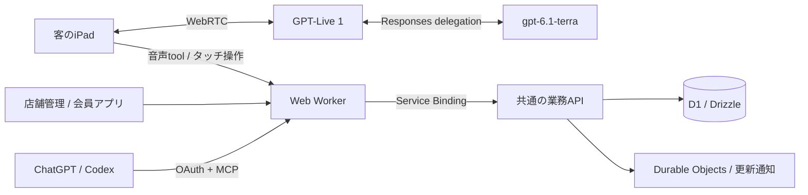

# TableCast

## 話せるメニューを、テーブルに。

料理選びをもっと楽しく。接客のゆとりを、お店に。

声で相談し、画面で選び、必要なときは店員につながる。飲食店の接客・注文・店舗運営をつなぐSaaSです。

発表：白田 連大

<!-- 話す内容：刺身に合う地酒を飲みたい。でも銘柄が分からないし、店員さんは忙しそう。そんなとき、メニューそのものに相談できたら。TableCastです。 -->

---

## 食べたいものは、メニュー名だけでは伝わらない。

| お客さまの希望                             | お店で起きる困りごと                           |
| ------------------------------------------ | ---------------------------------------------- |
| 刺身に合う辛口のお酒を、少しずつ飲みたい   | 銘柄・容量・価格を見比べるだけでは決めにくい   |
| この料理の食べ方や、避けたい食材を聞きたい | 言葉の壁があり、厨房への確認も必要になる       |
| 温かいものを少なめに頼みたい               | 慣れない画面を操作するたび、店員を呼んでしまう |

相談したいお客さまと、丁寧に応えたいお店。その間にある待ち時間と操作の壁を減らします。

<!-- 話す内容：注文ボタンを増やすだけでは、この困りごとは解決しません。欲しいのは、料理を選ぶための相談です。店員を置き換えるのではなく、店員にしかできない確認やおもてなしへつなげます。 -->

---

## 好みを話すと、料理選びが動き出す。

> 刺身に合う地酒を、辛口で。二人で少しずつ飲みたいので、量と値段も教えて。

| 相談する                               | 選ぶ                                   | 注文する                             |
| -------------------------------------- | -------------------------------------- | ------------------------------------ |
| 登録された商品・説明をもとに候補を探す | 写真を見ながら、量・温度・選択肢を選ぶ | 内容と価格を確認し、本人の承認で確定 |

声とタッチは同じ注文かごへ。音声を止めても、選んだ料理は残ります。

<!-- 話す内容：ここは実画面で、声とタッチが同じカートにつながるところを見せます。録画を用意する場合も、実行した操作と表示を使います。音声が使えない会場では画面で選択し、同じ注文確認へ進みます。 -->

---

## 分からないことを、分かったふりで終わらせない。

> 出汁に酒やみりんを使っていますか。厨房に確認してほしい。

| 客の相談                   | AIから店員へ渡すもの     | 店員の次の行動         |
| -------------------------- | ------------------------ | ---------------------- |
| 宗教上避けたい調味料がある | 質問原文と要約           | 用件を把握する         |
| 登録情報では判断できない   | 案内済みの内容と未解決点 | 厨房へ具体的に確認する |
| 回答を待っている           | 対象の卓と呼出し状態     | 卓へ向かって対応する   |

聞き直しを減らし、必要な対応から始められます。

<!-- 話す内容：多言語対応だけでは十分ではありません。未確認の食材を安全だと断定せず、人につなぐ必要があります。表示しているのはシナリオ用データを実APIへ保存した実画面です。実モデルの発話収録と混同しません。 -->

---

## 店舗の準備も、手元のお品書きから。

> このお品書きと料理写真から、税込価格と選択肢を保ってメニューを作って。英語・中国語・韓国語も用意して。営業時間と食べ方の資料は、接客で参照できる店舗Skillへ。分からない項目と変更差分を見せて。まだ公開しないで。

| 資料を渡す               | Agent Pluginが準備                 | 店舗が確認して公開             |
| ------------------------ | ---------------------------------- | ------------------------------ |
| お品書き・写真・営業案内 | 商品・翻訳・接客・参照資料の下書き | 価格・食材情報・表示・変更差分 |

ChatGPTやCodexをOAuthで接続。店舗の利用者に開発環境の構築を求めません。

<!-- 話す内容：導入する店長にも、手入力の負担があります。Pluginが現在の設定と不足を読み、資料から下書きを作ります。保存と公開を分けているので、AIに任せながら、お店が最後の判断を持てます。 -->

---

## 一度の注文で終わらず、お店の仕事につながる。

| 営業前                           | 営業中                         | 営業後                                 | 次の来店                                 |
| -------------------------------- | ------------------------------ | -------------------------------------- | ---------------------------------------- |
| お品書き・多言語・店舗資料を準備 | 相談・注文・提供・呼出しを管理 | 売上・商品注文率・呼出し件数を振り返る | 会員証・ポイント・クーポン・同意した記憶 |

> 昨日までの28日と、その前の28日を比較して。商品注文率と客単価、呼出し件数を根拠に、接客の改善案を3つ。変更対象と次に確認する指標も添えて。

提案を選んだら、同じ下書き・確認・公開の流れで接客へ反映できます。

<!-- 話す内容：客向けAIだけを作るのではなく、店が準備し、運用し、改善するところまでつなぎました。統計は閉卓した通常来店を対象にし、デモと営業データを分けています。売上が増えたという因果は、データなしに主張しません。 -->

---

## 自然な会話と、確実な業務処理を両立する。

| AIが担うもの                 | APIが決めるもの                        | 人が決めるもの                       |
| ---------------------------- | -------------------------------------- | ------------------------------------ |
| 希望の理解、資料の整理、提案 | 価格・売切れ・必須選択・店舗と卓の権限 | 注文の確定、設定の公開、未確認の事実 |

音声・GUI・MCPが同じ業務処理を使うため、入口が変わっても判断が揃います。

<!-- 話す内容：難しいのはモデルを呼ぶことより、会話と画面が並行しても注文状態を壊さないことです。状態はAPIとD1が持ち、モデルの発言を価格や権限の根拠にはしません。 -->

---

## 体験の細部まで、実行境界で確かめる。

| こだわり                       | 実装                               | 検証する境界                     |
| ------------------------------ | ---------------------------------- | -------------------------------- |
| 声とタッチを行き来できる       | 共通カート、音声停止後も状態を保持 | Browser操作と実Web・APIの代表E2E |
| 古い確認内容で注文しない       | 版付きスナップショット、明示承認   | API・実D1の版と競合              |
| AIの下書きが勝手に公開されない | 検証・差分・人の管理session        | 実MCP clientと公開認可           |
| 店舗を越えて情報を扱わない     | 店舗・卓・組織の認可               | OAuth scopeと業務API             |
| 画面だけの作例で終わらない     | SSR、端末Cookie、通知、実画像配信  | Chromium / WebKitの代表経路      |

[テスト戦略](../testing.md) · [実行結果と画面証拠のPR](https://github.com/kit-codex-hack-fes-2026/tablecast-poc/pull/432)

<!-- 話す内容：テスト件数の多さではなく、何を保証しているかを示します。実モデルの会話品質、実iPad、実店舗の効果は別の受入です。最新CIの成否は発表前にPRの対象SHAで確認します。 -->

---

## おいしかったを、また来たいへ。

| お客さま                       | お店                             |
| ------------------------------ | -------------------------------- |
| 会員証と来店の記録を持ち歩く   | 店舗ごとの会員サービスにつなげる |
| ポイント・クーポンを確認する   | 次の来店のきっかけを用意する     |
| 保存された好みを確認・編集する | 本人が同意した範囲で接客へ活かす |

次に確かめたいことは、初めての客が迷わず注文できるか、スタッフが引き継ぎを読んで対応できるか、店長が資料から準備を終えられるか。

<!-- 話す内容：サービスの可能性は、機能を増やすことだけではありません。客とスタッフと店長、それぞれの体験を実店舗で確かめて改善していきます。実店舗の導入効果が測定済みとは主張しません。 -->

---

## 選ぶ楽しさを、お客さまに。接客のゆとりを、お店に。

**TableCastは、料理の相談から、お店の準備と改善までつなぎます。**

- 声とタッチで、自分のペースで選べる。
- 答えきれない相談は、文脈ごと店員へ渡せる。
- お品書きから始め、店の判断で接客を育てられる。

[製品と利用シーン](https://tablecast.kit-codex.workers.dev/) · [GitHubと技術説明](../../README.md) · [利用ガイド](../use-cases.md)

<!-- 話す内容：一皿を選ぶ楽しさを、言葉や操作の壁で諦めてほしくない。お店が続けられる仕組みまで作る。それがTableCastです。 -->
