# TableCast

<!-- 構成方針：この原稿は作品の価値と完成度を扱う。元の説明・台本・画像を保持し、発表で実演する会話の優先度だけを strategy.md で整理する。ページ数・秒数を削減目標にしない。技術構成と検証の元原稿は technical.md に分けて保持する。 -->

<!-- 制作メモ：会話は、知らないことへの素朴な質問→説明から生まれる追加質問→試したい料理や食べ方の選択を中心とする。以下の会話は発表・収録用の想定台本であり、実モデルの逐語録ではない。場面写真は架空の利用シーン、製品画面は既存の実アプリ画像。商品・税込価格・選択肢は2026-10-31時点のこもれびfixtureを参照した。撮影前に実APIの価格・売切れ・必須選択を照合し、字幕は採用した実応答へ合わせる。出所・生成プロンプト・使い方は ../../apps/presentation/assets/images/pitch/README.md を参照。 -->

## 話せるメニューを、テーブルに。

料理選びをもっと楽しく。接客のゆとりを、お店に。

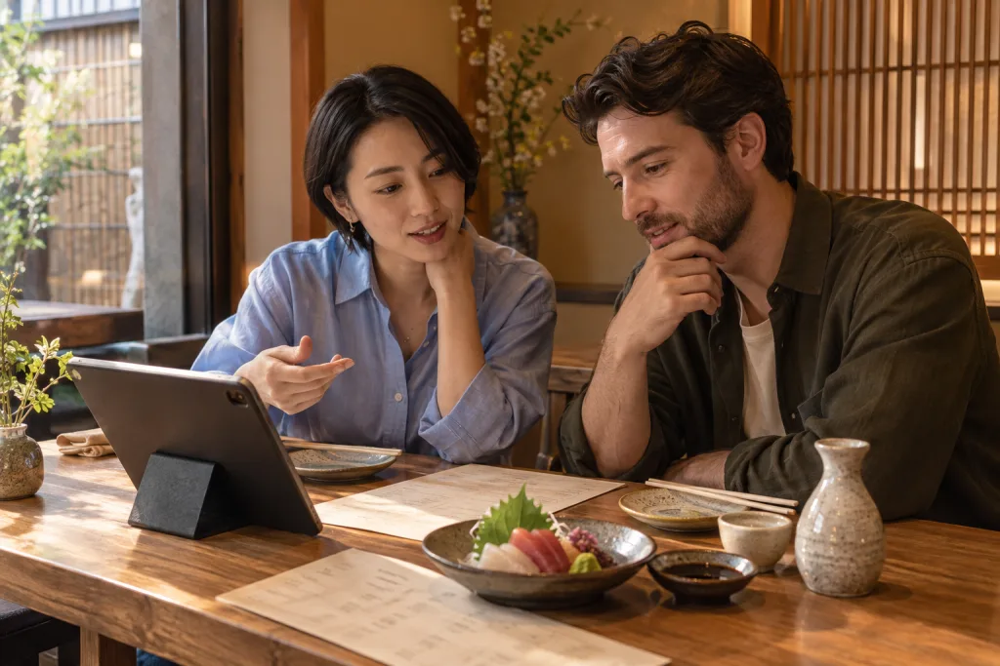

お客さまは、料理の背景や楽しみ方をTableCastに相談。お店は、手元のお品書きや写真をAgent Pluginへ渡して準備。飲食店の接客・注文・店舗運営をつなぐSaaSです。

発表：白田 連大

<!-- 話す内容：京都らしいものを食べたい。でも、どれを選び、どう味わえばよいか分からない。料理の背景を聞いてみたら、次に知りたいことも出てくる。その会話を、注文までつなぐのがTableCastです。店側も、お品書きや写真から準備を始められます。客が楽しく選べることと、店が導入・運用しやすいことを、両方お見せします。 -->

---

## メニューを読んだ、その先の疑問に答える。

| お客さまの出発点                                                 | 会話で分かること                                     |
| ---------------------------------------------------------------- | ---------------------------------------------------- |
| 京都に来たけれど、何を食べれば土地らしさを感じられるか分からない | 身近な料理と地域の食文化、その一皿の味わい方         |
| 日本酒を温めて飲んだことがなく、温度の選択肢を選べない           | 温める理由と、好みを探すための飲み比べ方             |
| 英語の料理名は読めても、どう組み合わせれば食事になるか分からない | 小皿を分け合う楽しみ方と、写真には見えない出汁の存在 |

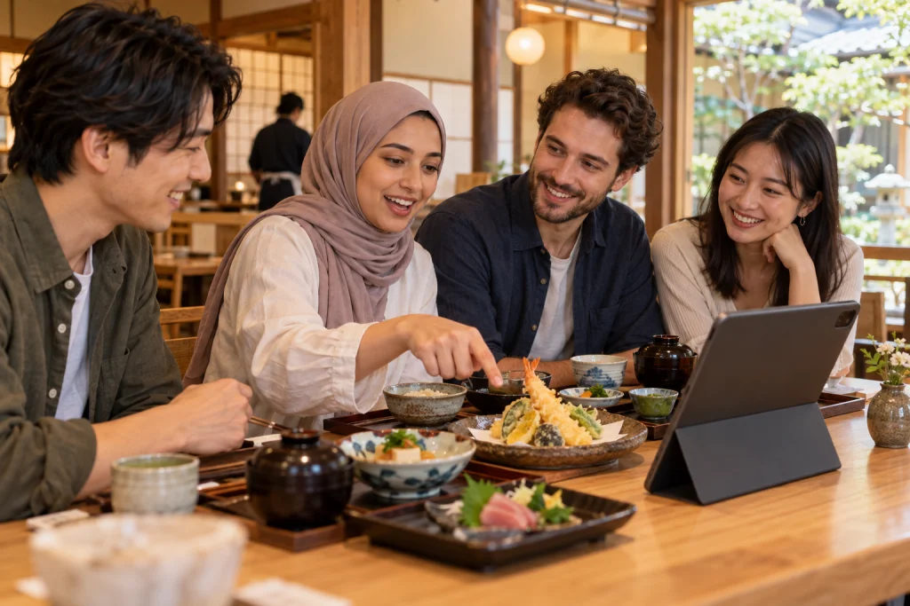

**説明を聞いて生まれた次の疑問にも答え、その人が試してみたい一品へつなぎます。**

<!-- 話す内容：価格や品数の確認より先に、料理を知る楽しさを見せます。固定の説明を読んで終わるのではなく、知らなかったことを聞き返し、自分に合う食べ方を決められることが中心です。一般的なメニューにも文化説明は載せられますが、その場の追加質問や好みに応じた相談まで会話で続けます。 -->

---

## お店の導入は、お品書きと写真を渡すところから。

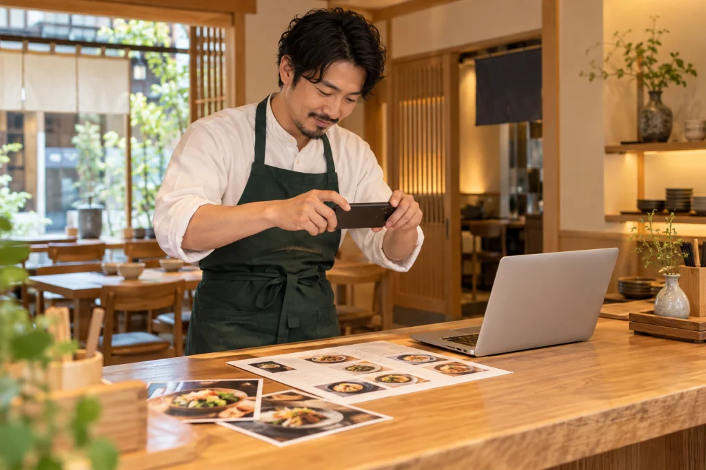

**Agent Pluginで、普段使うChatGPTやCodexからTableCastの店舗設定を頼めます。**

> このお品書きと料理写真から、税込価格と選択肢を保ってメニューを作って。英語・中国語・韓国語も用意して。営業時間と食べ方の資料は、接客で参照できる店舗Skillへ。分からない項目と変更差分を見せて。まだ公開しないで。

| 店長がすること                                      | Agent PluginとTableCastが支えること                    |
| --------------------------------------------------- | ------------------------------------------------------ |
| TableCastへログインし、扱う店舗と権限を確認して接続 | 接続した店舗の現在の設定と、準備が必要な項目を確認     |
| お品書き・写真・営業時間・料理の説明資料を渡す      | 商品・翻訳・接客資料を整理し、下書きと確認事項を用意   |
| 価格・食材情報・表示・変更差分を確認して公開        | 人が承認した内容を、お客さま向けのメニューと接客へ反映 |

**今ある資料から準備を進め、公開する内容はお店が決めます。** 店舗の利用者にリポジトリのcloneや開発サーバーの起動は求めません。

<!-- 話す内容：これから見せる料理の相談を、お店がどう用意するかも重要です。Agent Pluginへお品書きや写真を渡し、メニュー・翻訳・料理の説明を下書きにします。店長は不足を確認し、価格や内容を見て公開します。導入の接続はOAuthによる店舗と権限の同意が必要です。導入時間や実クライアントによる自然文依頼の完遂を測定済みとは言いません。客向けの卓上音声接客と、店長が使うAgent Pluginを区別して説明します。 -->

---

## 見慣れた一皿が、旅先で試したい料理になる。

<!-- デモ優先度：主軸。文化の質問から注文完了までを採用する。後の注文ページを同じ来店の続きとして使う。 -->

京都へ遊びに来た日本人の友人4人。美咲・健太・葵・亮は、京都らしい料理の選び方が分かりません。

| 話者             | 台詞                                                                                                                                                                 |
| ---------------- | -------------------------------------------------------------------------------------------------------------------------------------------------------------------- |
| 美咲 → TableCast | せっかく京都に来たんだけど、京都らしいものって、何から食べてみたらいい？                                                                                             |
| TableCast        | 身近な一品なら、出汁巻き卵はいかがですか。京都では日常の食卓でも親しまれていて、この店では1皿650円です。                                                             |
| 健太 → TableCast | え、卵焼き？ いつも食べてるのと、何が違うの？                                                                                                                        |
| TableCast        | 京都のだし巻きは、だしの味わいを楽しむのが特徴です。錦市場などの専門店でも作られ、店や家庭ごとに配合の違いがあります。この店の出汁巻きは、かつお出汁を使っています。 |
| 葵 → TableCast   | そういう違いなんだ。食べるとき、どこに注目したら分かる？                                                                                                             |
| TableCast        | まず何も足さずに一口、卵とだしの風味を確かめてみてください。ご自宅の卵焼きとの違いを探すと、楽しめそうです。                                                         |
| 亮 → TableCast   | それなら食べてみたい。出汁巻きを1皿と、お造り三種盛りも1皿。追加のトッピングや薬味の別添えはなしで。                                                                 |

**料理の背景を知ることで、いつもなら通り過ぎる一品を試したくなります。**

文化説明の出典：[農林水産省・だし巻き](https://www.maff.go.jp/j/keikaku/syokubunka/traditional-foods/menu/dasimaki.html)。

<!-- 演出：台詞はすべてTableCastへ、一人ずつiPadに向かって話す。知識を持っている人の確認問題にせず、卵焼きが提案された驚きから質問が続く口調にする。味わい方は提案。京都の一般的な文化を、この店の製法・歴史・砂糖不使用の証明にしない。写真は食卓の挿絵で、注文前後の連続写真ではない。注文確認は後のページで示す。 -->

---

## 知らなかった飲み方を、その場で試してみる。

<!-- デモ優先度：候補資料として全文と画像を保持。日本人グループの文化相談と役割が近いため、本番の追加実演には優先しない。 -->

日本酒は冷たいものしか飲んだことがない二人。燗の意味も、どう選ぶかも分かりません。

| 話者                    | 台詞                                                                                                                                                         |
| ----------------------- | ------------------------------------------------------------------------------------------------------------------------------------------------------------ |
| 客A → TableCast         | 日本酒って、どうして温めて飲むの？ 冷たいのしか飲んだことがなくて。                                                                                          |
| TableCast               | 温度で香りや味の感じ方が変わるからです。日本では季節や料理に合わせて、冷やしたり温めたりして楽しんできました。                                               |
| 客B → TableCast         | 寒いから温めるだけじゃないんだ。初めてなら、どう試すと違いが分かる？                                                                                         |
| TableCast               | 同じ銘柄を温度違いで比べる方法があります。この店の雪灯は米のうま味がある辛口で、冷酒とぬる燗を選べます。お試しは各60ミリリットルで540円です。                |
| 客A → TableCast         | ぬる燗って、熱燗とは違うの？ 熱すぎるのは苦手なんだけど。                                                                                                    |
| TableCast               | ぬる燗は、熱いというより温かいと感じる温度です。温めると香りや味のふくらみがどう感じられるか、冷酒と比べてみてはいかがですか。感じ方はお酒や好みによります。 |
| 客B → TableCast         | じゃあ雪灯を、冷酒とぬる燗でお試しを1杯ずつ。二人で違いを比べてみたい。                                                                                      |
| TableCast（追加成功後） | 雪灯のお試し60ミリリットルを冷酒とぬる燗で1杯ずつ、合計1,080円でかごに入れました。画面で内容をご確認ください。                                               |

**知らない選択肢を、楽しみ方を理解して選べる選択肢へ変えます。**

文化説明の出典：[日本酒造組合中央会・日本酒のおいしい飲み方](https://japansake.or.jp/sake/enjoy-sake/how-to-drink-sake/)。

<!-- 演出：独立した来店として空のかごから始め、同じ雪灯を異なる温度で2行にする。ぬる燗の実提供温度や、この銘柄の最適温度を保証しない。雪灯は架空銘柄であり実在の蔵元・産地・歴史を付けない。最後は画面で内容を確認して承認する。 -->

---

## 料理名が読めても、食事の楽しみ方はまだ分からない。

<!-- デモ優先度：文化の違いと、次のスタッフ引き継ぎを伝える場面。会話全文は読み合わせ・収録の候補資料として保持し、本番では必要なやり取りを選ぶ。外国語で話せることだけを見せ場にしない。 -->

英国から旅行中の友人3人、Emma・Daniel・Mei。英語メニューは読めますが、小皿が並ぶ食事をどう楽しむのか分かりません。

| 話者               | 英語の台詞                                                                                                                                                             | 日本語訳                                                                                                                            |
| ------------------ | ---------------------------------------------------------------------------------------------------------------------------------------------------------------------- | ----------------------------------------------------------------------------------------------------------------------------------- |
| Daniel → TableCast | We usually order a main course each. I'm not sure how to make a meal from this menu. Where should we start?                                                            | 普段は一人ずつメイン料理を頼むんですが、このメニューでどう食事を組み立てればいいか分かりません。何から始めればいいですか？          |
| TableCast          | Here you can share a few small dishes and add more as you go. Izakaya dining is often about trying different plates together.                                          | この店では小皿をいくつか分け合い、食べながら追加できます。居酒屋では、いろいろな料理を一緒に楽しむ食べ方がよく見られます。          |
| Emma → TableCast   | So we don't have to choose everything now? What about rice—is that a side dish?                                                                                        | 最初に全部決めなくていいんですね。ご飯は付け合わせなんですか？                                                                      |
| TableCast          | You can add dishes later. One way to eat here is small plates first, then rice or noodles to finish. That's a suggestion, not a rule.                                  | 後から追加できます。この店なら小皿から始め、最後にご飯や麺で締める楽しみ方もあります。決まりではないので、お好みでどうぞ。          |
| Mei → TableCast    | We'd like to try something we wouldn't make at home. What would you pick to start?                                                                                     | 家では作らないようなものを食べてみたいです。最初の一品なら何がおすすめですか？                                                      |
| TableCast          | Dashimaki tamago is a rolled omelette with dashi, for 650 yen. Dashi is a stock used to give many Japanese dishes their savoury flavour. This one uses bonito, a fish. | 出汁巻き卵はいかがですか。だしを使った卵料理で650円です。だしは多くの和食のうま味を支える汁で、この料理は魚のかつおを使っています。 |
| Daniel → TableCast | Fish in an omelette? Is dashi always made from fish?                                                                                                                   | 卵料理に魚が入っているんですか？ だしはいつも魚から作るんですか？                                                                   |
| TableCast          | No. Dashi can also be made from kelp or dried mushrooms. This omelette's recipe lists bonito stock, so this one does contain fish.                                     | いいえ、昆布や干ししいたけなどから取るだしもあります。ただ、この出汁巻きにはかつお出汁が使われています。                            |

**食事の組み立て方から、見た目では気づかない食文化まで。返答を聞いた先の疑問にも答えます。**

文化説明の出典：[JNTO・Izakaya Dining Guide](https://www.japan.travel/en/guide/dinner-at-a-japanese-tavern/)・[農林水産省・だしと和食の味わい](https://www.maff.go.jp/j/keikaku/syokubunka/culture/pdf/guide_all.pdf)。この店の食事の提案は登録済み店舗資料に基づきます。

<!-- 演出：英語の発話に日本語字幕を添える。料理名の翻訳や魚種の読み上げを見せ場にしない。一人一皿だと思っていた客が、共有する食事とだしを知る流れを演じる。全ての日本の店に同じ習慣があるとは説明しない。写真は店員対応も含む場面イメージ。端末の英語設定は準備し、自動言語判定・実モデル成功の証明にはしない。 -->

外国語で選ぶための画面にも、料理の意味と呼び名、予算感が分かる工夫をしています。

| 意味を知る                           | 呼び名を伝える                     | 価格をつかむ                       |
| ------------------------------------ | ---------------------------------- | ---------------------------------- |
| 商品名の意味訳で、どんな料理か分かる | 元の料理名の読みを転写で確認できる | 円価格と外貨の参考額を見比べられる |

<!-- 画面補足：意味訳・転写・外貨参考額は実画面で示す。換算額は収録時の表示を使い、支払いは円のまま。3点を見せる新しい素材は未収録で、既存の場面写真を機能の証拠にしない。 -->

---

## 知ったことで生まれた心配も、そのまま相談できる。

だしの説明を聞いたEmmaが、見た目に表れない調味料についても確認したくなった場面です。

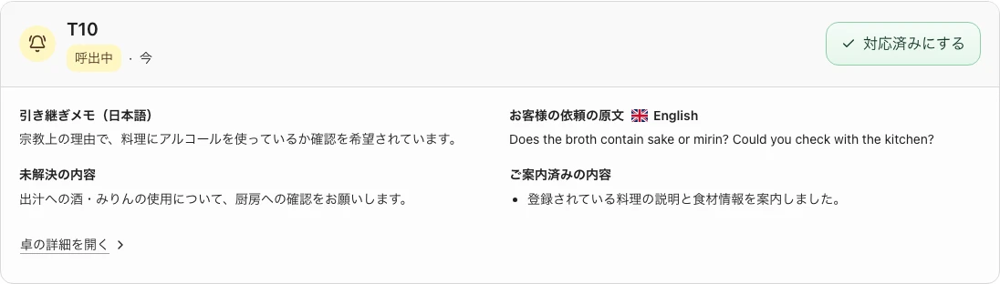

| 話者                      | 英語の台詞                                                                                                                                                                                    | 日本語訳                                                                                                                           |
| ------------------------- | --------------------------------------------------------------------------------------------------------------------------------------------------------------------------------------------- | ---------------------------------------------------------------------------------------------------------------------------------- |
| Emma → TableCast          | I hadn't realised there could be ingredients I can't see. I avoid alcohol in food for religious reasons. Would this omelette be OK for me?                                                    | 見えない材料もあるんですね。宗教上、料理に含まれるアルコールを避けています。この卵料理は食べても大丈夫でしょうか？                 |
| TableCast                 | I can't confirm that from the registered information. It lists eggs and bonito stock, but doesn't say whether sake or mirin is used. Shall I ask a member of staff to check with the kitchen? | 登録情報だけでは判断できません。卵とかつお出汁の記載はありますが、酒やみりんの使用は不明です。店員に厨房への確認を頼みましょうか？ |
| Emma → TableCast          | Yes, please. Please don't add it to our order yet.                                                                                                                                            | お願いします。まだ注文には入れないでください。                                                                                     |
| TableCast（呼出し成功後） | I've passed on your question and asked for a kitchen check. I haven't added the omelette to your basket.                                                                                      | ご質問を引き継ぎ、厨房への確認を依頼しました。出汁巻き卵はかごに入れていません。                                                   |

画面・演出：店員が、対象の卓・英語の質問原文・酒とみりんの使用確認という日本語要約・未注文であることを確認し、厨房へ向かう。

**一般的な料理の説明から、このお客さまに必要な個別確認へつなぎます。**

<!-- 演出：客が最初から酒・みりんの知識を持っている前提にしない。店員の動きは台詞から分ける。呼出し失敗時には成功の台詞を使わない。厨房の回答は台本で決めず、確認された事実だけを伝える。加熱したから問題ない、ハラールである、と断定しない。既存画像は別のシナリオ用データを実APIへ保存した画面で、この会話の実モデル出力ではない。 -->

---

## 話して見つけた一品を、そのまま注文できる。

日本人4人の注文例。文化の説明で終わらず、選んだ料理を共通のかごへ入れます。

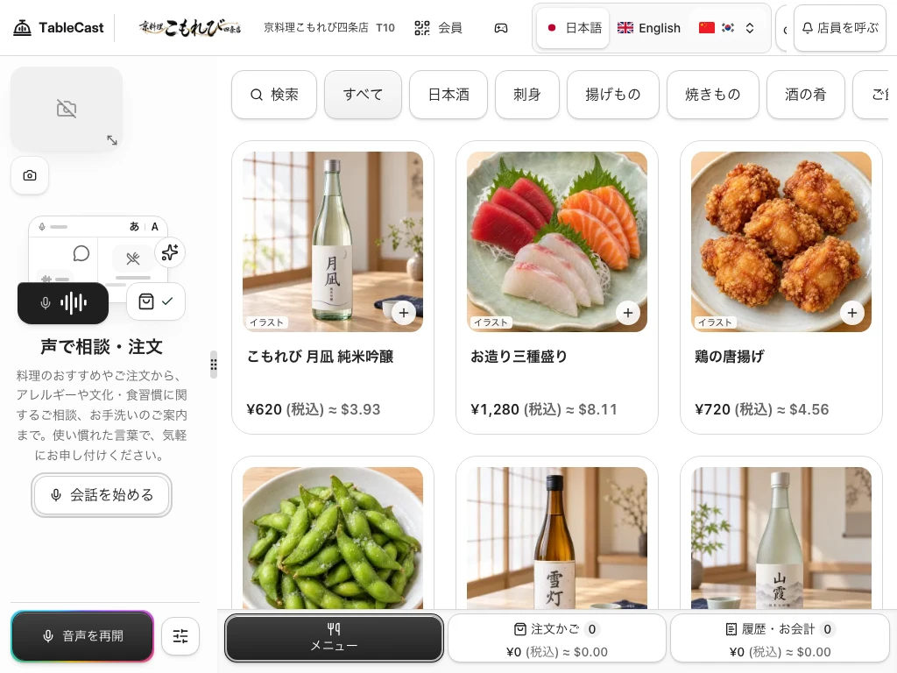

| 話者・操作                   | 台詞・画面で見せること                                                                                        |
| ---------------------------- | ------------------------------------------------------------------------------------------------------------- |
| TableCast（追加成功後）      | 出汁巻き卵1皿650円、お造り三種盛り1皿1,280円をかごに入れました。合計1,930円です。まだ注文は確定していません。 |
| 美咲 → TableCast             | ありがとう。この2品を、画面でも確認してから注文するね。                                                       |
| TableCast                    | はい。画面で品目と数量、合計をご確認のうえ、ご注文ください。                                                  |
| 葵が音声停止をタップ         | 送音と応答が止まり、2品・合計1,930円のかごは残る。                                                            |
| 美咲が注文内容を確認して承認 | 最新の品目・数量・税込合計を確認して確定する。成功後の注文表示を見せる。                                      |

**知る、試したくなる、選ぶ。その続きで、本人が確認して注文します。**

<!-- 演出：このページは文化相談の後に短く示す。価格や合計の確認だけを主な会話実演にしない。音声停止後にTableCastの台詞や自動再開を足さない。既存画像は今回の2品・1,930円を実行した証拠ではない。実演は空のかごから、追加料金なし・売切れなしで始める。確認中にかごが変わった場合は最新内容で確認し直す。 -->

| UI・UXの工夫                                       | お客さまにとっての価値                       |
| -------------------------------------------------- | -------------------------------------------- |
| 会話しながら料理写真と注文かごを見られる           | 言葉で聞いた候補を、自分の目でも確かめられる |
| 声とタッチで同じ注文かごを扱う                     | 途中で操作方法を変えても、選び直さずに済む   |
| 音声停止後も注文内容を保ち、本人が確認して確定する | 自分のペースで数量と価格を確かめて注文できる |

---

## 導入後も、同じAgent Pluginでお店の接客を育てる。

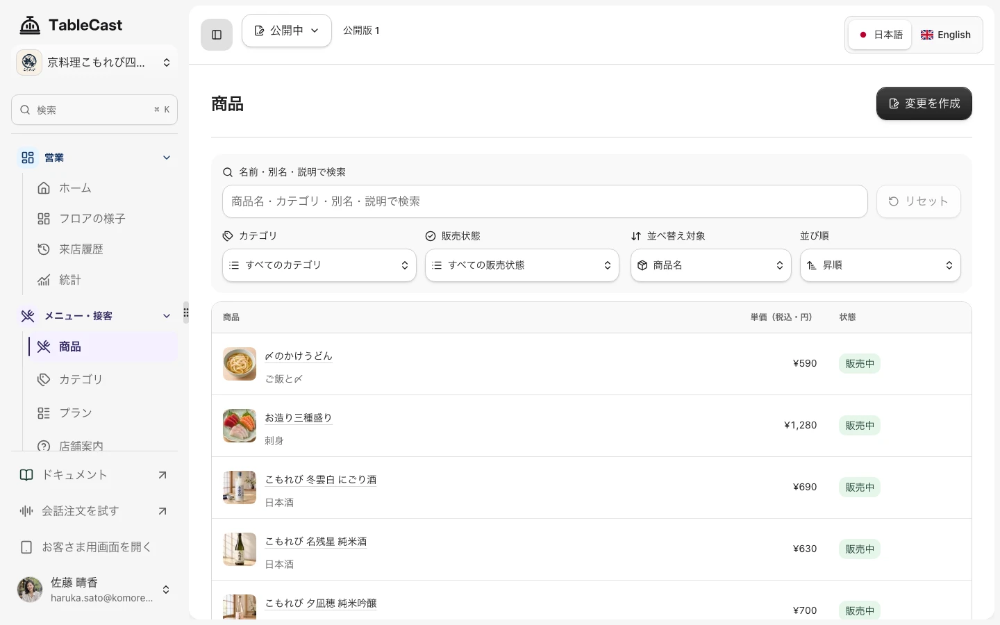

店長は同じAgent Pluginに、営業後の振り返りや接客の改善も相談できます。

| 営業前                           | 営業中                         | 営業後                                 | 次の来店                                 |
| -------------------------------- | ------------------------------ | -------------------------------------- | ---------------------------------------- |
| お品書き・多言語・店舗資料を準備 | 相談・注文・提供・呼出しを管理 | 売上・商品注文率・呼出し件数を振り返る | 会員証・ポイント・クーポン・同意した記憶 |

> 昨日までの28日と、その前の28日を比較して。商品注文率と客単価、呼出し件数を根拠に、接客の改善案を3つ。変更対象と次に確認する指標も添えて。

提案を選んだら、同じ下書き・確認・公開の流れで接客へ反映できます。

<!-- 話す内容：客向けAIだけを作るのではなく、店が準備し、運用し、改善するところまでつなぎました。統計は閉卓した通常来店を対象にし、デモと営業データを分けています。売上が増えたという因果は、データなしに主張しません。 -->

<!-- 以下のAgent Plugin実演は、2026-10-31にstagingの再ログイン・OAuth再接続・ツール更新後、ChatGPTで新たに実行した会話。前の客向け想定台本とは異なり、スクリーンショットは今回の実応答を示す。seedで作られた合成履歴は通常来店の集計対象にも入るため、このデータを実営業の成果と扱わない。 -->

---

## 営業後、数字を見ながら次の工夫を相談する。

店長が、普段使うChatGPTからTableCastに相談します。表を転記しなくても、接続した店舗のデータを使って振り返れます。

> 京料理こもれび四条店の直近28日（2026年10月3日〜30日）の売上と人気商品を、前の28日と比べて。注文数・注文率の上位5品と、メニューや接客で改善できることを3つ教えて。現在のデータを取得して、設定はまだ変更しないで。stagingの合成データを使うデモです。

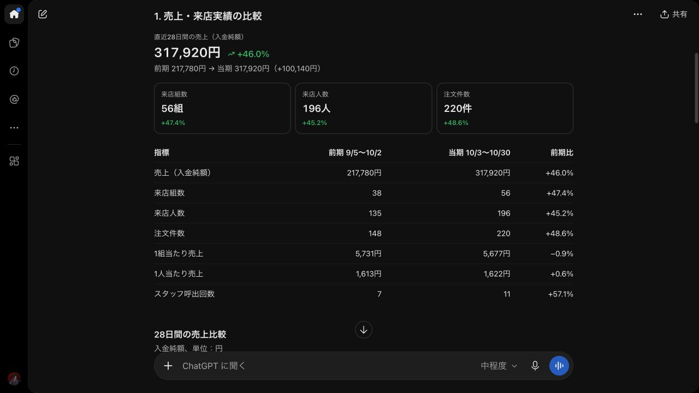

2026年10月31日の実画面。stagingの合成データを使用。10月3〜30日の56組・196人と、9月5日〜10月2日の38組・135人を比較しています。

| 会話で返ってきたこと                                                                            | 店長が考えられること                                                       |
| ----------------------------------------------------------------------------------------------- | -------------------------------------------------------------------------- |
| 売上合計は217,780円から317,920円へ増加。一方、1組あたりの売上は5,731円から5,677円で、ほぼ横ばい | 合計の増加だけで判断せず、来店組数と1組の注文内容を分けて振り返る          |
| 鶏の唐揚げは56組中23組が注文。お造り三種盛りの注文率は23.7%から16.1%へ低下                      | よく選ばれる料理からの追加提案や、選ばれにくくなった料理の伝え方を検討する |
| 改善案と、次に見る商品注文率・1組あたりの売上・呼出し件数などを提示                             | 試す施策を選び、次回の振り返りにつなぐ                                     |

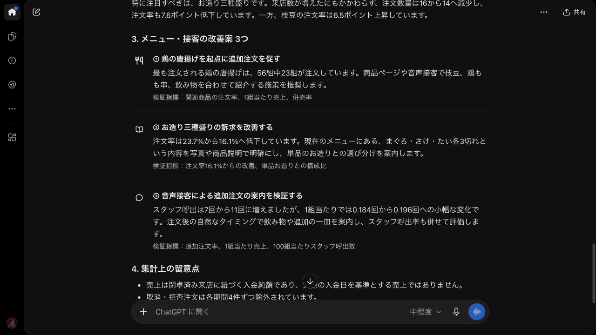

**店舗の数字を見て、次に何を試すかまで相談できます。** このデモの増減は合成データの期間比較であり、TableCastによる売上改善の実績ではありません。

<!-- 話す内容：店長が相談すると、TableCastから現在のデータを取得して比較します。合計が増えたという報告だけで終わらず、一組の売上や商品ごとの注文率から、次に試す案まで返します。画面は新しく実行した会話の抜粋。応答速度や効果を示す動画ではありません。 -->

---

## 選んだ改善案を、同じ会話から下書きへ。

分析を見た店長が、お造り三種盛りの伝え方を改善します。料理名の訳だけでなく、初めて食べる人が量や楽しみ方を想像できる説明を頼みます。

| 話者・操作           | 会話と結果の要点                                                                                                                                                                      |
| -------------------- | ------------------------------------------------------------------------------------------------------------------------------------------------------------------------------------- |
| 店長 → Agent Plugin  | 2つ目の改善案を試したい。お造り三種盛りの英語説明を、生の魚を少しずつ味わう料理で、各3切れ・計9切れを取り分けて楽しめると伝わる文にして。下書きに保存して検証まで。まだ公開しないで。 |
| Agent Plugin         | 現在の店舗設定を取得し、英国英語の説明文を作成。下書きへの保存後、変更前後と検証結果を提示。                                                                                          |
| 店長が管理画面を開く | 変更前と変更後を並べて確認。英語説明だけが変わり、価格1,280円、画像、食材情報、他の言語、その他60商品は保持されている。                                                               |

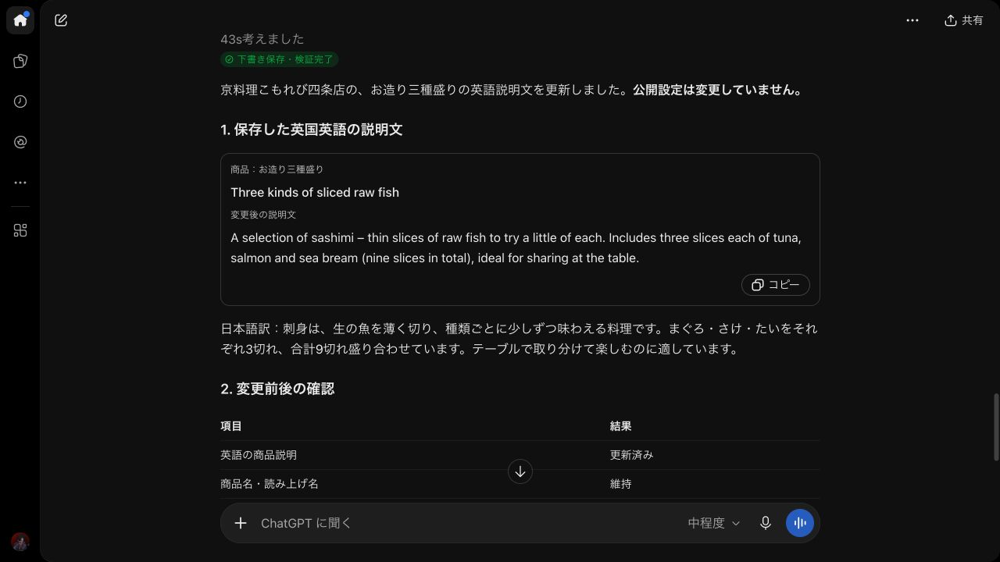

実際に保存された説明文：

> A selection of sashimi – thin slices of raw fish to try a little of each. Includes three slices each of tuna, salmon and sea bream (nine slices in total), ideal for sharing at the table.

日本語での意味：生の魚を少しずつ味わう刺身の盛り合わせ。まぐろ・さけ・たい各3切れ、合計9切れを、テーブルで取り分けて楽しめます。

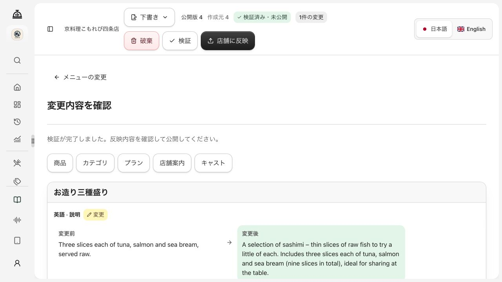

2026年10月31日の実画面。変更1項目、検証エラー0件、検証済み・未公開。管理画面を再読み込みして保存状態も確認しました。今回の実演は下書きまでで、公開申請・公開は行っていません。

**普段の言葉で頼み、実際のメニュー設定まで進める。最後は店長が内容を見て公開を決めます。** 導入時の資料整理から、営業後の振り返りと改善まで、同じAgent Pluginを使えます。

<!-- 話す内容：分析を読むだけで終わらず、良さそうな案をそのまま頼めます。ここでは初めて日本料理を食べる人への説明を改善しました。ChatGPTの返答と、TableCastに保存された差分の両方を見せます。表の会話は実行内容の要約で、完全な入力文と実行記録は素材READMEへ記録しています。技術的な接続方式・ツール名・設定構造の説明は別スライドに回します。 -->

---

## 名前を思い出せない料理も、記憶を手がかりに探せる。

年配の夫婦。昔の旅で食べた料理の名前が分からず、覚えている食べ心地から相談します。短い発表では補足に回せる場面です。

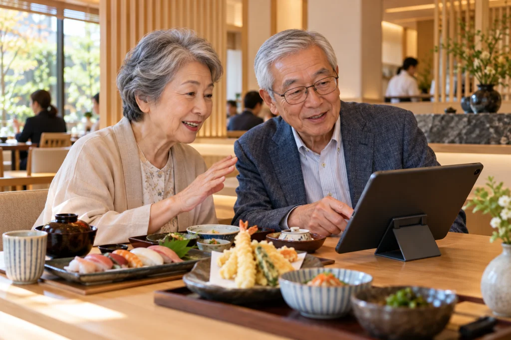

| 話者                    | 台詞                                                                                                                               |
| ----------------------- | ---------------------------------------------------------------------------------------------------------------------------------- |
| 夫 → TableCast          | 昔、旅館の最後に出てきた、さらさらっと食べるご飯が忘れられなくて。名前を覚えていないんですが、似たものはありますか？               |
| TableCast               | ご飯に温かい汁がかかっていましたか？                                                                                               |
| 妻 → TableCast          | そうです。お茶とは違う香りがして、魚も少しのっていました。                                                                         |
| TableCast               | 出汁茶漬けに近いかもしれません。この店には、焼きざけとご飯に選んだだしを合わせる、さけの出汁茶漬けがあります。1杯680円です。       |
| 夫 → TableCast          | だしの香りだったのかな。同じ料理かは分からないけど、近いものを試してみたいです。                                                   |
| TableCast               | それでしたら、かつお出汁から試してみてはいかがですか。追加料金はありません。                                                       |
| 妻 → TableCast          | それをかつお出汁で一つ。追加トッピングはなしで。温かい緑茶も二つください。                                                         |
| TableCast（追加成功後） | さけの出汁茶漬け、かつお出汁で1杯680円と、温かい緑茶2杯、1杯340円です。合計1,360円をかごに入れました。画面で内容をご確認ください。 |

**料理名や検索語を知らなくても、その人の経験から候補を絞れます。**

<!-- 演出：思い出の料理を特定したと断言しない。過去の来店履歴や記憶を取得したのではなく、今話した内容だけから候補を提案する。妻が画面の品目・出汁・数量・温かい緑茶・税込合計を確認して承認する。年齢に応じて操作能力を決めつけず、自然な口調で演じる。 -->

---

## おいしかったを、また来たいへ。

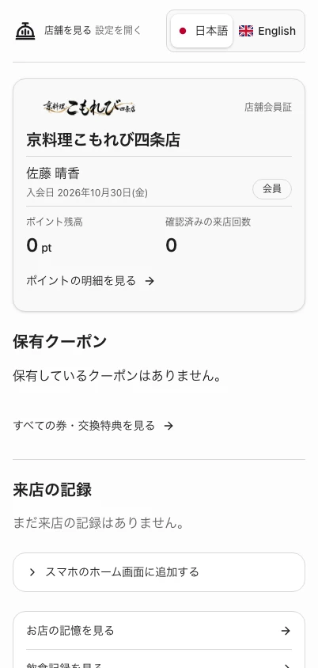

| お客さま                       | お店                             |
| ------------------------------ | -------------------------------- |
| 会員証と来店の記録を持ち歩く   | 店舗ごとの会員サービスにつなげる |
| ポイント・クーポンを確認する   | 次の来店のきっかけを用意する     |
| 保存された好みを確認・編集する | 本人が同意した範囲で接客へ活かす |

次に確かめたいことは、初めての客が迷わず注文できるか、スタッフが引き継ぎを読んで対応できるか、店長が資料から準備を終えられるか。

<!-- 話す内容：サービスの可能性は、機能を増やすことだけではありません。客とスタッフと店長、それぞれの体験を実店舗で確かめて改善していきます。実店舗の導入効果が測定済みとは主張しません。 -->

---

## 選ぶ楽しさを、お客さまに。接客のゆとりを、お店に。

**TableCastは、料理の相談から、お店の準備と改善までつなぎます。**

- 料理の背景や楽しみ方を聞き、自分の好みで選べる。
- 答えきれない相談は、文脈ごと店員へ渡せる。
- Agent Pluginへお品書き・写真を渡して準備し、営業後の改善まで続けられる。

[製品と利用シーン](https://tablecast.kit-codex.workers.dev/) · [GitHubと技術説明](../../README.md) · [利用ガイド](../use-cases.md)

<!-- 話す内容：一皿を選ぶ楽しさを、言葉や操作の壁で諦めてほしくない。店側はAgent Pluginで今ある資料から始め、確認して公開し、営業後にも改善する。お客さまの選ぶ楽しさと、お店の導入・運用のしやすさをつなぐのがTableCastです。 -->
