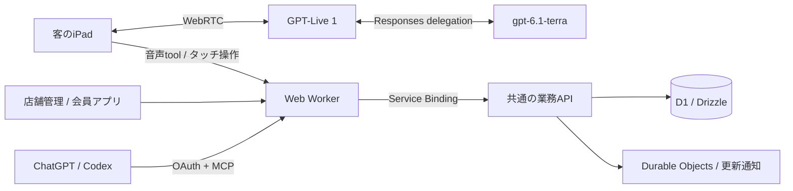

# TableCast — 技術説明用の別スライド

<!-- 価値・完成度の原稿から分けた元の技術説明を保持する。構成図・検証の説明はこの別スライドで扱う。記載は元の原稿からの移動であり、今回の新しい実行検証ではない。 -->

## 自然な会話と、確実な業務処理を両立する。

| AIが担うもの                 | APIが決めるもの                        | 人が決めるもの                       |
| ---------------------------- | -------------------------------------- | ------------------------------------ |
| 希望の理解、資料の整理、提案 | 価格・売切れ・必須選択・店舗と卓の権限 | 注文の確定、設定の公開、未確認の事実 |

音声・GUI・MCPが同じ業務処理を使うため、入口が変わっても判断が揃います。

<!-- 話す内容：難しいのはモデルを呼ぶことより、会話と画面が並行しても注文状態を壊さないことです。状態はAPIとD1が持ち、モデルの発言を価格や権限の根拠にはしません。 -->

---

## 体験の細部まで、実行境界で確かめる。

| こだわり                       | 実装                               | 検証する境界                     |
| ------------------------------ | ---------------------------------- | -------------------------------- |
| 声とタッチを行き来できる       | 共通カート、音声停止後も状態を保持 | Browser操作と実Web・APIの代表E2E |
| 古い確認内容で注文しない       | 版付きスナップショット、明示承認   | API・実D1の版と競合              |
| AIの下書きが勝手に公開されない | 検証・差分・人の管理session        | 実MCP clientと公開認可           |
| 店舗を越えて情報を扱わない     | 店舗・卓・組織の認可               | OAuth scopeと業務API             |
| 画面だけの作例で終わらない     | SSR、端末Cookie、通知、実画像配信  | Chromium / WebKitの代表経路      |

[テスト戦略](../testing.md) · [実行結果と画面証拠のPR](https://github.com/kit-codex-hack-fes-2026/tablecast-poc/pull/432)

<!-- 話す内容：テスト件数の多さではなく、何を保証しているかを示します。実モデルの会話品質、実iPad、実店舗の効果は別の受入です。最新CIの成否は発表前にPRの対象SHAで確認します。 -->
