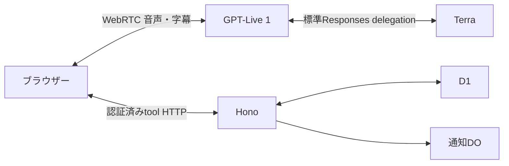

# GPT-Live・Responses delegation・Honoの接続

## 採用構成

ブラウザーからGPT-Live 1へ標準WebRTCで接続する。GPT-Liveの標準Responses delegationにgpt-6.1-terraを設定し、接続・会話文脈・推論の継続をOpenAIへ任せる。Mastra、LiveKit、hosted Agents API、独自STTは利用しない。

公式OpenAI SDKのLive session作成をHonoが行い、SDPだけをブラウザーへ返す。APIキーはサーバーだけが持つ。backendはTABLECAST_MODELのTerra、reasoning low、verbosity low、Fast mode（service_tier: priority）、最大4096出力tokenとする。出力上限は推論tokenも含むため、従来の800から推論用の余地を増やす。独立したtoolはparallel_tool_callsを許可し、書込みや版に依存する操作は順序を保つ。

[公式Delegation仕様](https://developers.openai.com/api/docs/guides/live-delegation)、[GPT-6.1 Terra](https://developers.openai.com/api/docs/models/gpt-6.1-terra)

## ツールと出力

Liveのresponse.event内のresponse.createdでresponse IDを記録し、response.output_item.doneのfunction_callからcall_id・name・argumentsを収集する。response.completedのoutputは空配列になり得るため、その配列からtool有無を判断しない。必要な結果をresponse.item.createで全件返してからresponse.createで一度だけ継続する。

ブラウザーはHonoの認証済みtool経路へ転送する。価格計算、認可、注文・カート操作をブラウザーへ複製しない。業務の失敗はtool結果へ返し、音声接続を維持する。古い委任の遅着結果で次の委任を継続しない。

商品検索は最大8件とtotal/moreを返し、offsetで続きへ進む。商品紹介はgetCatalog(show=true)で検索と最大4枚のカード表示をまとめる。概要にもrequiredSelectionsを返し、注文する商品を特定したらgetCatalogのproductIdsへ最大8件まとめて指定して必須・任意の選択肢、追加料金、条件を含む詳細を取得する。検索語の一致度によらず詳細を取得でき、画面での選択を依頼しない。getTableStateは最後に会話へ表示したdisplayedProductIdsも画面と同じ順で返す。showMenuSearch(query, offset)は空白以外のqueryを必須としてメニューペインの検索結果を開き、画面と同じ8件の商品ID順・概要・total/more・版を返す。getCatalogと共通の検索・ページ切出しを使い、検索画面の表示順はgetTableStateのmenuSearch.productIdsから確認する。会話内カードのdisplayedProductIdsとは別に扱う。setUiSectionのsearch省略は検索を保持し、nullで通常一覧へ戻る。setUiSectionはメニューペインの一覧・商品詳細・カート・履歴・会計への遷移を担当する。代表発話と失敗時の契約は[接客シナリオ](scenarios.md)を参照する。ツール結果からGUIのイベント履歴・二言語の注文snapshotの重複を除き、価格・版・必須選択・認可の検査は維持する。

### 外貨参考額と端末の表示設定

`getCatalog`・`getTableState`・`updateCart`・`prepareConfirmation`・`submitOrder`は、円のフィールドを保持し、`displayCurrency`へ通貨・レート・基準日・状態、金額のあるobjectの`approximate`へ参考額を返す。数量・件数・版は換算しない。読取2toolの`quoteCurrency`は今回の回答だけを指定し、画面の通貨は変更しない。`setDisplayCurrency({ currency })`は明示依頼時だけ使い、nullは円のみとする。自発接客へ変更toolを公開しない。

初期化APIの公開レートをHTTP envelopeの`displayCurrency`（currency・revision・rates）で受け取り、画面と同じ参考レートで計算する。レートは補助表示だけに使い、円の価格・注文・会計の根拠にはしない。呼出しのたびに外部レートを取得せず、全通貨データをモデルへ複製しない。署名・トークン・レートの永続化は設けない。

表示変更の応答には`displayCurrencyAction`を添える。ブラウザーは現行音声・委任とrevisionを確認して端末内の選択を適用し、その後にtool結果を返す。手動変更後の遅着指示を破棄し、後続toolへ新しい表示設定を送る。通貨変更で音声停止・カート更新・注文確認失効を起こさない。取得不能時の参考額はunavailableとし、円の業務処理を維持する。

## 字幕・保存・停止

session.input_transcript.delta / session.output_transcript.deltaを受信時に表示する。字幕の表示順は追加後に入れ替えず、保存したD1履歴を再開時に復元する。強い会話履歴の整合性や字幕の到着を注文承認の証明にはしない。生音声は既定で保存しない。

注文はAPIの版付きsnapshotと、その案内後の明示承認を必要とする。同じ委任で確認準備と承認を行わず、APIも作成turnと異なる現行turnを検査する。委任IDは物理的な発話境界の証明ではない。停止・設定変更・カート変更は古い確認を無効化する。

停止はcapture・再生を即時終了し、APIで音声sessionを失効させ、Liveへsession.closeを送る。API側でも標準sideband接続でsession.closedを確認する。明示再開まで自動再接続しない。確定したカート・注文は停止で戻さない。

自発接客は30秒の無言と店舗設定、空カート、確認・スタッフ呼出・進行中turnの有無をAPIで検査する。参照専用turnで商品を取得し、一商品の事実をLiveへ渡す。客の発話や承認として保存しない。

## 観測と検証

HonoのHTTP、tablecast.voice.tool、D1と通知をGrafanaで追う。tool spanにツール名・call ID・voice session/turn・実行時間・結果byte数を記録する。OpenAI内部をアプリの計測で観測できた扱いにしない。

性能目標はツール受付→結果返却、利用者の発話終了→実返答音声開始の双方1秒以下。待機案内や字幕到着を実再生の代わりにしない。成功率・使用token・標本数と超過区間を残す。

実D1テストは認可・価格・版・同時実行・停止・別卓拒否を検証する。voice-performance.test.tsは商品数を増やし、実D1のSQL実行と保存されたカード表示を確認しながらbinding往復と出力サイズの予算を検証する。上限超過時は原因を調べ、閾値の緩和で成功扱いにしない。

Webの固定イベント試験は全tool結果の返却・一回の継続・エラー・新委任による取消・字幕・停止を検証する。実GPT-LiveとTerraは有料試験で、Inworld生成音声を使いlocalと同一SHAのPR previewで確認する。通常CIの固定イベントだけで実API・音声・1秒達成を証明した扱いにしない。

## 言語変更と接客終了

言語変更は現在のsession IDを保持し、APIの標準sidebandでResponsesの接客指示とLiveの言語指示を更新してACKを確認する。古いturnと確認は失効する。更新の失敗で音声接続を閉じず、同じ言語の操作も再試行できる。声の種類は次の接続から変更する。

接客不要の意思はendConversationへ委任する。注文確認へのそれで大丈夫ですと終了意思を区別し、不明なら確認する。終了toolは後続の業務操作を拒否し、一言の挨拶後の出力無音または最大5秒で既存の明示停止経路へ進む。生音声は保存せず、明示再開まで再接続しない。

## カメラ画像

カメラは利用客のON操作で有効になる。captureCameraはAPIで卓・session・turnを認可してから現在映像を1枚だけ取得する。圧縮JPEGはWebRTCの転送上限内で標準Responsesのinput_imageへ送り、DB・R2・ログへ保存しない。getCameraStateは同じAPI認可を通し、画像取得や許可要求をせず、端末のoff・starting・ready・capturing・reading・permission-denied・unavailableを返す。APIがsessionAuthorizedを返し、Webがデバイス識別情報を含まない現在のcamera状態とpermission（granted・denied・prompt・unknown）を付加する。対応ブラウザーではPermissions APIを照会し、PermissionStatus.stateの現在値を都度参照して変更を追従する。照会未対応はunknownとする。端末の自己申告をAPI認可の根拠にはせず、認可やON/OFFを客に調べさせない。OFF・取消・取得失敗は状態付きのtool結果として返し、音声を維持する。

内側・外側の切替はカメラだけを更新し、旧トラックを解放する。内側プレビューだけ鏡像とし、取得画像はソースの向きを保つ。非表示・停止・言語変更後の未送信画像は破棄する。取得中はカメラ枠、読取中はspinnerと日英の状態文で示す。Browserのlocal-camera-reading試験はChromium/WebKitの実MediaStreamとJPEG decodeを使う。

## Web検索と参考情報

Responses delegationは標準の`web_search`と`reasoning: { effort: "low", summary: "auto" }`を使う。Webは検索イベント・公開された推論要約・URL出典だけを表示し、要約が返らない場合も応答待ちをspinnerで示す。言語変更・発話・停止後の古い表示は破棄する。検索は一般知識や参考案内に使い、価格・在庫・原材料・アレルギー・注文判断は既存業務APIを根拠とする。

`showReference`は現在の卓・音声session・turnを認可して会話へ参考カードを追加する。URL、タイトル、説明、OGP画像、中央favicon付きのQRを表示し、画像取得に失敗してもURLとQRを残す。ページHTMLは描画しない。メタデータ取得は公開HTTPSだけとし、DNSのprivate address、認証情報、非標準portを拒否する。転送先も再検査し、全体3秒、HTML 256 KiB、redirect 3回で打ち切る。一つのturnの参考カードは3件まで、QRへ渡すURLはUTF-8で1000 byteまでとする。画像検索専用の非公開パラメーターは使わず、検索した参照ページのOGPを画像の表示経路とする。

## 店舗資料の検索と顧客記憶

店舗固有の営業時間・アクセス・予約・設備・背景は、公開版の`cast.skills`を`searchStoreKnowledge`で検索する。空queryはSkill一覧、短いキーワードは最大5件の1200文字以内の抜粋を返す。`readStoreKnowledge`はSKILL.mdまたは参照ファイルを最大4000文字ずつ返す。検索結果は版・Skill ID・ファイルパス・原文の文字位置を持つ。続きは同じquery・版と`nextOffset`を使い、版競合時は検索からやり直す。デモだけは取り込んだ設定版を読む。本文全体を接続開始のpromptへ挿入せず、必要な資料だけ段階的に取得する。

検索は導入済みFuse.jsによる日英のキーワード検索であり、意味embeddingや別ベクトルDBは使わない。該当なしなら語を変えて探し、根拠がなければ未登録と説明する。店舗資料には公開してよい情報だけを保存し、顧客記憶・秘密情報を入れない。任意のテキストファイルを原文保持できるが、Skillのコード・frontmatter・命令は参照データであり実行しない。価格・在庫・原材料・食事対応・プランは現在の業務APIを優先する。

顧客記憶は現在の接客対象と同意を`getCustomerContext`で確認し、必要なら`searchCustomerMemories`で古い記憶も検索する。検索は最大8件、更新日時とIDのcursorで続きを取得できる。本人の今回の訂正を過去の記憶より優先し、好みを注文や承認へ変換しない。店舗資料と個人記憶の取得・保存先を混ぜず、Web検索へ個人情報を送らない。個人記憶の店舗・本人・同意・音声文脈の失効は最終SQLでも検査する。

代表質問は`infra/observability/tablecast-eval-cases.json`へ日英で記録する。固定ツールと実DBの検証は実モデルの回答品質を証明しない。実モデルの比較は既存の`tablecast:eval`とLangfuseのsession snapshotを使い、対象SHA・入力・モデル・token・結果を区別して記録する。

## 接客プロンプトの2層

1. TableCastシステムは日英の標準方針を持ち、通常は編集しない。`cast.systemInstructions`は任意の日英上書きで、それぞれ本文またはnullとする。未設定とnullは標準へ戻す。上書きは非推奨の明示操作で有効化し、本文の上限は各5,000文字。
2. 店舗の`cast.instructions`は従来どおり話し方・キャラクター・接客方針の参照データとして扱う。開始案内・音声・自発接客の設定も店舗側に置く。

利用可能な業務ツールの名前と用途は実際の登録情報から生成し、標準web_searchの説明とともにLiveと委任先のsystem instructionsへ追加する。Liveは業務ツールを直接実行せず標準delegationへ委任する。モデルごとの役割・言語・画像の扱い・注文手順は実行時に追加し、店舗や標準本文の編集でAPIの認可・明示承認・版照合は変更しない。開始時とsidebandの言語更新は同じ日英上書きの解決方法を使い、既存の下書き・差分・公開・履歴・MCPで同じ設定を扱う。

## 店員呼び出し前の用件相談

音声開始の`purpose`は`conversation`（既定）または`assistance`とする。用件相談では通常の開始挨拶に代えて用件を一度尋ね、既存接続中は同じLive接続へ文脈を渡す。用件ボタンの選択は参照データとして渡し、注文や人の呼び出しの承認には使わない。音声停止・接続取消後の遅着から接続や吹き出しを再開しない。

`getServiceGuidance`は公開された店舗案内と関連商品を取得し、通常の客発話では`assistance.shown`通知で用件相談の吹き出しを表示できる。店舗の自由文は認可・価格・承認規則を変更しない。`callStaff`は今回の用件の日本語要約・原文・案内済み内容・未解決点を共通の呼び出し処理へ渡す。人を明確に希望する場合は追加の案内を繰り返さず呼び出す。実音声・実モデルの誘導品質は固定tool・transportを使う自動試験と別に確認する。
